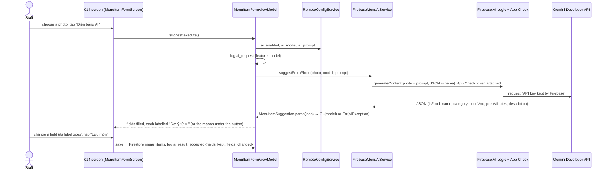

# AI feature: Gemini fills the K14 "Thêm món mới" form from a dish photo

Final assignment, handout section 8 (1.0 point). Issue #96. Level **2** of the handout: structured output (JSON → Dart
model) that the user confirms.

## 1. The step it helps

Staff add an item in **K14 "Thêm món mới"** (staff menu flow: K08 "Món" → + → K14 → "Lưu món" → K08). It is the
screen where staff type the most: name, kind, price, preparation time and a description. With the photo of the dish
already chosen for the item (the photo box of K14), **"Điền bằng AI"** asks Gemini to fill all five fields. Staff
check them, change what is wrong, and save as before. Nothing is written until they press "Lưu món".

K15 (editing an item) has no AI button: it would overwrite what staff wrote. The design change is D36 in
`docs/design-traceability.md`.



## 2. How each requirement of the handout is met

| Requirement (handout section 8) | How | Where |
|---|---|---|
| Gemini through **Firebase AI Logic** (Gemini Developer API) | `FirebaseAI.googleAI().generativeModel(...)`; the Gemini key is created and kept by Firebase, the app holds no API key. Spark (no-cost) plan | `mobile/lib/data/services/firebase/firebase_menu_ai_service.dart` |
| **Structured output**, confirmed by the user (level 2) | `responseMimeType: application/json` + a `responseSchema` (all six keys required); the JSON becomes the Dart model `MenuItemSuggestion`; staff confirm by saving | `packages/core/lib/domain/models/menu_item_suggestion.dart` |
| **App Check** | Activated at start-up before any Firebase call: the debug provider with a registered debug token on test devices, Play Integrity for other builds. `firebase_ai` attaches the token to every AI request; Firestore requests carry it too. Registered in the console (App Check → Apps → BreakBite, debug token "Emulator Mikan") | `mobile/lib/config/firebase_setup.dart` (`activateAppCheck`), `mobile/env/app_check.example.json` |
| **Remote Config**: model, prompt, on/off | `ai_enabled` (bool, in-app default **false**), `ai_model` (string), `ai_prompt` (string). The view model listens to Remote Config updates, so switching `ai_enabled` off in the console hides the button **without reopening the screen**; the model and prompt are read at every request | `RemoteKeys` in `packages/core/lib/data/services/remote_config_service.dart`, `firebase/remote-config-defaults.json` |
| **Quota and network errors**: the flow works without AI | Every failure is an `AiException` with a reason (`quota`, `network`, `not_food`, `bad_output`, `other`, `disabled`); the form keeps what staff typed, the reason stays in red under the button until another photo is chosen, and "Lưu món" works by hand. A 30 s timeout counts as `network` | `AiException` in `packages/core/lib/domain/app_exception.dart`; tests in §5 |
| **No personal data** | Only the photo and the prompt are sent: no name, e-mail, uid or account data. The hint under the button says "Chỉ chụp món, không chụp người"; the prompt tells the model not to describe people. The AI events carry the feature, the model and counts only | `MenuAiService` (its only inputs), `docs/analytics-plan.md` |
| **Label** the AI output and let the user **edit** it | A notice "Gợi ý từ AI. AI có thể sai: kiểm tra và sửa…" above the fields, and "Gợi ý từ AI" under every field the AI filled. Changing a field removes its label; all fields stay editable | `menu_item_form_screen.dart` (`_AiNotice`, `helperText`), `MenuItemFormViewModel.isAiSuggested` |
| Log `ai_request`, `ai_result_accepted`, `ai_error` | `ai_request {feature, model}` when asked; `ai_error {feature, reason, model}` on a failure; `ai_result_accepted {feature, fields_kept, fields_changed}` when an item the AI filled is saved | `MenuItemFormViewModel`; plan in `docs/analytics-plan.md` |

## 3. Prompt and schema

`ai_prompt` (Remote Config, same text as the in-app default):

> Bạn là trợ lý nhập món cho quầy ăn trong trường đại học ở Việt Nam. Nhìn ảnh và điền thông tin cho một món đang
> bán. Nếu ảnh không phải đồ ăn hoặc đồ uống, đặt isFood = false và để trống các trường khác. Tên món ngắn gọn bằng
> tiếng Việt, tối đa 40 ký tự. Giá gợi ý theo mức giá căng tin sinh viên, đơn vị đồng, làm tròn đến 1.000. Thời gian
> chuẩn bị tính bằng phút. Mô tả một câu, tối đa 120 ký tự, không nhắc đến người trong ảnh.

The user turn is the photo and "Điền thông tin món trong ảnh này." `ai_model` is `gemini-3.5-flash-lite`
(temperature 0.2).

Response schema (`FirebaseMenuAiService.responseSchema`): `isFood` (boolean), `name` (string), `category` (enum
`food` / `drink` / `other`), `priceVnd` (integer), `prepMinutes` (integer), `description` (string), all required.

`MenuItemSuggestion.parse` does not trust the answer: it rounds the price to 1 000 đ and drops one ≤ 0 or above
1 000 000 đ, keeps the time between 1 and 120 minutes, cuts the name and description to the form's limits, maps an
unknown kind to "Khác", strips a ```` ```json ```` fence, and turns anything that is not this JSON into `bad_output`.

## 4. Three real inputs and outputs

Run on 12/11/2026 on the Android emulator `BB_Pixel7`, staff account of Kiosk Q9 · Tầng 2, real Firebase project
`breakbite-1315b`. The raw answers are in `evidence/ai/gemini-answers.txt` (printed by debug builds only).

| # | Input (photo chosen in K14) | Gemini's JSON | What K14 showed | Screenshots |
|---|---|---|---|---|
| 1 | `packages/core/assets/images/menu/banh-mi.jpg` | `{"isFood": true, "name": "Bánh mì pate chả lụa", "category": "food", "priceVnd": 20000, "prepMinutes": 3, "description": "Bánh mì giòn rụm kẹp nhân thịt nguội, chả lụa, đồ chua và rau mùi tươi ngon."}` | Name, "Món ăn", 20000, 3 phút and the description, each labelled "Gợi ý từ AI", notice on top | `evidence/ai/output-banh-mi-photo.png`, `output-banh-mi-fields.png` |
| 2 | `packages/core/assets/images/menu/tra-dao.jpg` | `{"isFood": true, "name": "Trà đào mát lạnh", "category": "drink", "priceVnd": 15000, "prepMinutes": 3, "description": "Ly trà đào thanh mát kèm đá viên giúp giải nhiệt ngày hè."}` | "Đồ uống" chosen (the model told a drink from food), 15000, 3 phút | `evidence/ai/output-tra-dao-photo.png`, `output-tra-dao-fields.png` |
| 3 | `packages/core/assets/images/menu/com-ga.jpg` | `{"isFood": true, "name": "Cơm gà sốt teriyaki", "category": "food", "priceVnd": 35000, "prepMinutes": 10, "description": "Cơm gà sốt teriyaki đậm đà ăn kèm mè rang và hành lá thơm ngon."}` | "Món ăn", 35000, 10 phút | `evidence/ai/output-com-ga-photo.png`, `output-com-ga-fields.png` |

The prices (15 000 – 35 000 đ) are in the range of the real menu (18 000 – 42 000 đ), and the names match the dishes
in the photos. The AI cannot know this kiosk's own price, which is why every value stays a labelled suggestion.

`evidence/ai/k14-ai-off.png` is K14 with `ai_enabled` off (no button); `evidence/ai/k14-ai-on.png` is the same screen
after the console turned it on.

## 5. Failures handled

**A photo that is not food (shown in the video).** Input: the BreakBite logo
(`packages/core/assets/brand/breakbite_logo.png`). Gemini answered
`{"isFood": false, "name": "", "category": "other", "priceVnd": 0, "prepMinutes": 0, "description": ""}`.
`parse` turns it into `AiException(not_food)`: no field is touched, the red line under the button says "Ảnh này
không giống món ăn hay đồ uống. Chụp lại món hoặc nhập tay.", `ai_error {reason: not_food}` is logged, and the
item can still be typed and saved by hand (`evidence/ai/failure-not-food.png`, ARTEMIS TC-41).

**A failure found while building it.** The first schema marked price, time and description optional; on the
emulator Gemini then answered with the name and the kind only, and the price stayed empty. Making every key required
(and letting `isFood = false` mark a photo that is not food) fixed it: all five fields are filled in the three runs
above.

**A message that was too short-lived.** The failure was first shown in a snackbar that disappears after about
4 seconds, so a staff member (and the ARTEMIS agent, 3–5 s per step) could miss it. It is now a red line under the
button that stays until another photo is chosen.

Quota (`QuotaExceeded`), network (`SocketException`, `ClientException`, the 30 s timeout), an unreadable answer and
any other error are covered by unit tests: `mobile/test/ui/seller_menu/menu_item_form_ai_test.dart` checks for each
reason that what staff typed stays, the reason is shown and logged, only `bad_output` and `other` go to Crashlytics,
and the item can still be saved.

## 6. Tests

| Test | What it checks |
|---|---|
| `mobile/test/domain/models/menu_item_suggestion_test.dart` | JSON → model: a full answer, rounding and limits, missing values, unknown kind, a code fence, not food, garbage, no name |
| `mobile/test/ui/seller_menu/menu_item_form_ai_test.dart` | Remote Config on/off live, K15 without AI, model and prompt from Remote Config, only the photo sent, fields filled and labelled, a changed field loses its label, `ai_request` / `ai_result_accepted` / `ai_error` with their parameters, every failure reason, the reason staying until another photo |
| `mobile/test/ui/seller_menu/menu_item_form_screen_test.dart` (group "K14 AI") | No button while off; the button waits for a photo, fills the fields and shows the labels; a failure shows why and leaves the form empty |
| `e2e_test/test_ai_feature.py` (ARTEMIS) | TC-40: a dish photo fills K14 (name, price, "Món ăn", the label). TC-41: the logo is refused, the name stays empty and typing still works. Results in `docs/test-plan.md` section 3.4 |

## 7. Running it and the demo

1. Firebase console: AI Logic enabled with the Gemini Developer API; Remote Config `ai_enabled = true`.
2. Copy `mobile/env/app_check.example.json` to `mobile/env/app_check.json` (gitignored) with a debug token registered
   in App Check → Apps → BreakBite → Manage debug tokens, then
   `flutter run --dart-define-from-file=env/cloudinary.json --dart-define-from-file=env/app_check.json` in `mobile/`.
3. Sign in with a staff account → Món → + → choose a photo → "Điền bằng AI".

For the video: show K14 with the button, run it on a dish photo, then set `ai_enabled` to false in the console and
publish: the button disappears on the phone without reopening the screen; set it back to true and it returns.

App Check enforcement: AI Logic can be enforced at any time (the Lab 3 build never calls it). Firestore is enforced
only once every client sends tokens (this app does; the web admin needs App Check too, see #98) and after the Lab 3
demo, because the Lab 3 build has no App Check.

## 8. AI tools used for this feature

Claude Code (Anthropic) wrote most of the code, the tests and this document from the handout and the issue; the
team member reviewed and ran it on the emulator and is able to explain it.
