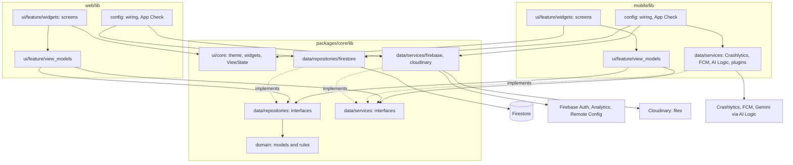
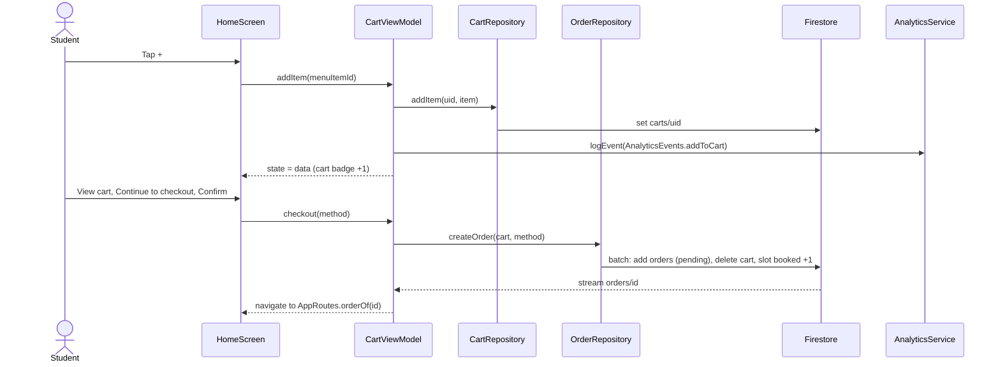

# Architecture

MVVM with Provider and go_router, following the official Flutter architecture guide ([docs.flutter.dev/app-architecture](https://docs.flutter.dev/app-architecture)): a **UI layer** (views and view models, grouped by feature) on top of a **data layer** (repositories and services, grouped by type). Dependencies only point downward; a lower layer never imports a higher one.

For the final assignment the repository is a **monorepo of one system**: two Flutter clients (the Android app and the web admin) built on one shared package, and one Firebase project.

| Folder | Package | What it is |
|---|---|---|
| `packages/core/` | `breakbite_core` | Shared by both clients: domain models and rules, repository and service interfaces, their Firestore and Firebase implementations, the Lab 2 design system (tokens, theme, widgets, logo, Nunito), `Result`, `Command`, `ViewState` |
| `mobile/` | `breakbite` | The Android app: customer screens (S01–S30) and the kiosk staff app (K01–K15) |
| `web/` | `breakbite_admin` | The web admin (Flutter Web on Firebase Hosting): W01–W05 for staff and admins, and the admins' system pages |
| `firebase/` | — | Firestore rules and indexes, their tests, Remote Config template, Hosting config, seed and migration scripts |
| `e2e_test/` | — | Google ARTEMIS cases (pytest) for the mobile app |

## 0. Why the layout differs from the handout's suggestion

The handout suggests `lib/models/`, `services/`, `firebase/`, `viewmodels/`, `screens/`, `widgets/`, `utils/` and allows another layout if this document explains why. We use the layout of the official Flutter architecture guide for three reasons:

1. **Five people work in parallel.** With 45 mobile screens, layer-first folders (`screens/`, `viewmodels/`) would each hold about 45 files from five owners. One folder per feature (`lib/ui/<feature>/`) matches the ownership in `ASSIGNMENTS.md`, so people rarely edit the same files.
2. **The handout's "service" covers two different jobs.** Wrapping an SDK (Auth, Crashlytics, FCM…) and owning business data (menu, cart, orders in Firestore) change for different reasons. The guide calls the first a service and the second a repository; both are "services" in the sense of section 5 of the handout: every external call goes through one, and they are injected so a ViewModel can be tested with a fake.
3. **Two clients share one data layer.** The web admin reads and writes the same collections as the app, under the same rules. Models, repositories and the Firebase services that both clients need live once in `packages/core/`; each client keeps only its UI, its wiring and the services that need a platform plugin. In Lab 3 these were already separate from the UI (`lib/domain/`, `lib/data/`), so the split for the final assignment was a move of folders, not a rewrite (commit `5cd0019`).

| Handout suggestion | This repo |
|---|---|
| `lib/models/` | `packages/core/lib/domain/models/` (rules that span models: `packages/core/lib/domain/`) |
| `lib/services/` | `packages/core/lib/data/services/` (SDK wrappers) and `packages/core/lib/data/repositories/` (business data); app-only services in `mobile/lib/data/services/` |
| `lib/firebase/` | `mobile/lib/config/` and `web/lib/config/` (setup, App Check, wiring) and the Firebase implementations under `packages/core/lib/data/` |
| `lib/viewmodels/` | `mobile/lib/ui/<feature>/view_models/`, `web/lib/ui/<feature>/view_models/` |
| `lib/screens/` | `mobile/lib/ui/<feature>/widgets/<name>_screen.dart`, `web/lib/ui/<feature>/widgets/` |
| `lib/widgets/` | `packages/core/lib/ui/core/widgets/` (Lab 2 components, shared by both clients) |
| `lib/theme/` | `packages/core/lib/ui/core/theme/` (the single place for tokens; `admin_theme.dart` adapts them to the web) |
| `lib/utils/` | `packages/core/lib/utils/` |

## 1. Folder structure

```
packages/core/lib/                  breakbite_core: shared, never imports an app
  domain/
    models/                         plain data classes, one file per model, models.dart exports them all
    app_exception.dart              the one error type that crosses layers
    order_pricing.dart, cart_repricing.dart, credentials.dart   rules that span several models
    mobile_access.dart, web_access.dart                         which role may use which client, and the message if not
  data/
    repositories/                   interfaces: menu, cart, order, user, slot, voucher, review, incident, report,
                                    favorite, notification, announcement, session
      announcement_inbox_repository.dart   the customer's inbox: own notifications + published announcements, live
      admin/                        interfaces of the admins' system pages (users, kiosks, slots, vouchers, orders,
                                    incidents, audit log)
      firestore/                    Firestore implementations; firestore_mappers.dart; admin/ (with audit_writer.dart)
      local/                        InMemorySessionRepository (selected kiosk)
    services/                       interfaces: auth, analytics, crash, messaging, remote config, storage, connectivity,
                                    photo picker, menu AI, reminders, order alerts, report files; analytics_events.dart
      firebase/                     Auth (Google Sign-In 7 and e-mail), Analytics, Remote Config implementations
      cloudinary/                   StorageService on Cloudinary
    firebase/                       shared by every Firebase implementation: error mapping (guard), Stamp, readDate, fetchPage
  ui/core/                          theme/, widgets/, view_state.dart, placeholder_screen.dart
  utils/                            result.dart, command.dart, safe_change_notifier.dart, paged.dart, streams.dart, format.dart

mobile/
  lib/
    main.dart                       entry point with real Firebase
    app.dart                        MaterialApp, providers, router
    firebase_options.dart           generated by flutterfire configure
    config/
      dependencies.dart             AppDependencies: every service and repository, exposed one by one through Provider
      firebase_dependencies.dart    builds the Firebase implementations
      firebase_setup.dart           Firebase.initializeApp, App Check, optional local emulators
    routing/
      router.dart                   GoRouter, redirect by sign-in and role, tab shells
      routes.dart                   AppRoutes: every path as a constant
      routes_p1.dart … routes_p5.dart   each owner wires their own screens here
    data/                           services that need an Android plugin: Crashlytics, FCM and the notification inbox,
                                    Firebase AI Logic (menu AI), connectivity_plus, image_picker, local notifications, PDF;
                                    order_status_notifier.dart, break_reminder_scheduler.dart
    ui/<feature>/
      view_models/                  <name>_view_model.dart
      widgets/                      <name>_screen.dart and widgets used only by this feature
  dev/                              OUTSIDE lib/: never part of the submitted build
    main_dev.dart                   entry point with fake data
    fake_dependencies.dart          createFakeDependencies()
    fakes/                          in-memory fakes of every service and repository, also used by tests
  test/                             mirrors lib/ (test/ui/home/…, test/routing/…); helpers/ (pumpScreen); architecture_test.dart

web/
  lib/
    main.dart                       initializeFirebase, activateAppCheck (reCAPTCHA Enterprise), then the app
    app.dart                        MaterialApp.router with the admin theme
    firebase_options.dart           the web app's config
    config/
      admin_providers.dart          adminProviders(): the provider tree, buildable with fakes on the VM
      dependencies.dart             firebaseProviders(): the Firestore implementations from packages/core
      firebase_setup.dart           Firebase.initializeApp, App Check, optional local emulators
      browser_connectivity.dart     ConnectivityService on navigator.onLine and the online/offline events
    routing/
      router.dart                   AdminRoutes, redirect by sign-in and role
      system_pages.dart             the admins' system pages
    ui/
      shell/                        AdminSession (signed-in user, role, kiosk picker, online state) and the rail
      auth/  review_queue/  menu_management/  dashboard/  announcements/    W01 … W05
      system/<page>/                users, kiosks, slots, vouchers, orders, incidents, stats, audit
  test/                             fakes.dart, view model and screen tests, system/, architecture_test.dart
```

There is no `web/lib/data/` or `web/lib/domain/`: the web admin has no model or repository of its own (checked by a test, rule 9).

## 2. Layers



| Layer | Responsibility | Knows about |
|---|---|---|
| Screen (`<app>/lib/ui/<feature>/widgets/`) | Draws the ViewModel's state, forwards taps | Its ViewModel, `ui/core` of the shared package, the app's routes |
| ViewModel (`<app>/lib/ui/<feature>/view_models/`) | Screen state (`ViewState`), filtering, validation, calls to repositories and services | Repository and service **interfaces**, models |
| Repository (`packages/core/lib/data/repositories/`) | Reads and writes business data, turns documents into models, hides queries | Models, Firestore (in its implementation only) |
| Service (`packages/core/lib/data/services/`, implementations also in `mobile/lib/data/`) | Wraps one external SDK, holds no business data | The SDK (in its implementation only) |
| Model (`packages/core/lib/domain/`) | Immutable data and pure rules (for example `Voucher.discountFor`, `Announcement.reaches`) | Nothing, not even Flutter |
| Wiring (`<app>/lib/config/`) | Builds the implementations once and hands them to Provider | Everything below it |

## 3. Rules (graded)

1. Screens and ViewModels never import `package:firebase_*`, `package:cloud_firestore`, `package:google_sign_in` or `http`; only implementations under `data/` and the apps' `lib/config/` may.
2. Filtering, ranking, aggregation and validation live in a ViewModel or repository, not in `build()`.
3. Every screen that loads data has an explicit state model owned by the ViewModel (`sealed class ViewState`: loading, empty, error, data).
4. Repositories and services are injected through the constructor; a ViewModel can be tested with a fake (`mobile/dev/fakes/`, `web/test/fakes.dart`).
5. No `setState` for shared state; no singleton accessed directly from a widget.
6. Paths come from `AppRoutes` / `AdminRoutes`, analytics event names from `AnalyticsEvents`, Remote Config keys from `RemoteKeys`, spacing from `AppSpacing` (names match the Figma tokens), never typed by hand.
7. `mobile/lib/` never imports `dev/`. The submitted build therefore contains no fake data.
8. One-shot operations of repositories and services return `Future<Result<T>>` (`packages/core/lib/utils/result.dart`) with an `AppException` (`packages/core/lib/domain/app_exception.dart`) on failure; nothing is thrown across layers. Realtime data is a `Stream<T>`. ViewModels handle every failure: show its message and log it (details: `CONTRIBUTING.md` section 7).
9. **(final assignment)** `packages/core` never imports an app, so both clients can depend on it; models in `packages/core/lib/domain/` do not import Flutter; the web admin has no `lib/data/` or `lib/domain/` of its own.

Checked on every `flutter test`:

| Check | `mobile/test/architecture_test.dart` | `web/test/architecture_test.dart` |
|---|---|---|
| Rule 1: no SDK import in screens, view models, routing (and, on mobile, in `packages/core` domain and `ui`) | yes | yes |
| Rule 3: view models import only `package:flutter/foundation.dart`, never a widget | yes | yes |
| Every view model mixes in `SafeChangeNotifier` (no `notifyListeners` after `dispose`) | yes | yes |
| Rule 6: no colour or text-style literals in feature screens | yes | yes |
| Rule 7: `lib/` never imports `dev/` | yes | — (the web has no `dev/`) |
| Rule 9: `packages/core` never imports an app; domain without Flutter | yes | — |
| Rule 9: no `lib/data/` or `lib/domain/` in the web admin | — | yes |

### MVVM check across the repo (T72, 07/11/2026)

Rules 1, 3, 6 (literals) and 7 are enforced by the architecture tests and pass. The other rules were checked by reading every file under `lib/ui/*/widgets/` of the app (searches for repository or service reads, `DateTime.now()`, `where`, `fold`, `reduce`, `sort` and `await` in widgets), on `main` plus the screens of PR #71. Paths below are under `mobile/lib/ui/` since the split.

| # | Where | Rule | Finding | Decision |
|---|---|---|---|---|
| M1 | `order_manage/widgets/order_detail_screen.dart` (S12) | 2 | `build()` filtered the receipts to drop the one just uploaded | Fixed: `OrderDetailViewModel.earlierReceipts`, tested |
| M2 | `order_manage/widgets/order_history_screen.dart` (S11) | 2 | `build()` computed the highest day of the chart with `fold` | Fixed: `OrderHistoryViewModel.mostSpentInADay`, also used by `peakWeekday`, tested |
| M3 | `seller_shop/widgets/shift_stats_screen.dart` (K11) | 2 | `build()` filtered and joined the kiosk, shift and update labels | Fixed: `ShiftStatsViewModel.shiftLine`, tested |
| M4 | `home/widgets/quick_reorder_sheet.dart` (S14, PR #71) | 4, 5 | `showQuickReorderSheet` reads the repositories and services from `context` to build its ViewModel | Kept: a bottom sheet is not a `GoRoute`, so this function plays the role of the route builder (rule 4 still holds: the ViewModel gets everything through its constructor and is tested with fakes). It only builds the ViewModel; nothing in the sheet calls a repository |
| M5 | `await` in widgets (cart, K03, K13, K08, demo area, S12…) | 2 | Widgets await ViewModel commands | Kept: they only wait to show a dialog, snack bar or to navigate with the result; the work itself is in the ViewModel |

No other violation was found: no widget imports an SDK, calls `DateTime.now()` or holds shared state with `setState`. The web admin was written to the same rules and its architecture test has passed since it was added; the web screens keep the kiosk choice in `AdminSession` and key each screen's view model by kiosk ([#111](https://github.com/baonv0817/PRM393_Lab03_Group2/pull/111)) instead of passing state between screens.

## 4. Sequence diagrams

### Placing an order (F1, mobile)



### Across the two clients

The cross-role flows (the web approves or rejects an order and the phone's S07 changes live; an admin's announcement reaches the phone's inbox) have their own sequence diagrams, rules and measured times in [`cross-role-flow.md`](cross-role-flow.md). Both clients use the same `OrderRepository` and `AnnouncementRepository` from `packages/core`, so a status written by the web is read by the phone through the same mapper.

## 5. Features, owners, ViewModels and dependencies

### Mobile (`mobile/lib/ui/…`)

One folder per feature; the owner created it when building the first screen.

| Folder | Screens | Owner | ViewModel | Depends on |
|---|---|---|---|---|
| `onboarding/` | S01 | P1 | (uses `AuthViewModel`) | — |
| `home/` | S02, S21, S14 | P1 (S14: P5) | `HomeViewModel`, `QuickReorderViewModel` (S14) | `MenuRepository`, `CartRepository`, `OrderRepository`, `SessionRepository`, `RemoteConfigService` (live updates), `AnalyticsService`, `CrashService` |
| `menu/` | S03, S04, S22 | P1 | `MenuViewModel`, `ItemDetailViewModel`, `AlternativesViewModel` | `MenuRepository`, `CartRepository`, `AnalyticsService` |
| `cart/` | S05, S25, S29 | P1 | `CartViewModel`, `PickupTimeViewModel`, `VoucherPickerViewModel` | `CartRepository`, `SlotRepository`, `VoucherRepository`, `MenuRepository`, `AnalyticsService` |
| `checkout/` | S06, S06-GATEWAY | P1 | `CheckoutViewModel` | `OrderRepository`, `CartRepository`, `AnalyticsService`, `CrashService` |
| `orders/` | S07, S08 | P1 | `OrderTrackingViewModel`, `OrdersViewModel` | `OrderRepository` |
| `order_manage/` | S09, S10, S11, S12, S20, S23, S24 | P2 | `EditOrderViewModel` (S09), `OrderCancelledViewModel` (S10), `OrderHistoryViewModel` (S11), `OrderDetailViewModel` (S12), `PickupViewModel` (S20), `ReviewViewModel` (S23), `IncidentViewModel` (S24); S11, S23 and S24 live here because they open from or lead to S12 | `OrderRepository`, `CartRepository` and `SessionRepository` (reorder), `AnalyticsService`, `CrashService`; S09 also `MenuRepository`; S12 also `ReportFileService`, `StorageService`, `ReportRepository` (PDF receipt); S23 `ReviewRepository`; S24 `IncidentRepository` |
| `seller_menu/` | K08, K09, K14, K15 | P2 | `SellerMenuViewModel` (K08, K09), `MenuItemFormViewModel` (K14, K15; the AI suggestion of the final assignment) | `MenuRepository` (the kiosk comes from `AppUser.kioskId`), `PhotoPickerService`, `StorageService`, `MenuAiService`, `RemoteConfigService`, `AnalyticsService`, `CrashService` |
| `seller_shop/` | K10, K11 | P2 | `ShopViewModel` (K10), `ShiftStatsViewModel` (K11) | `MenuRepository` (`watchKiosks`, `updateKiosk`), `OrderRepository` (`kioskStats`), `CrashService` |
| `auth/` | S26 | P3 | `AuthViewModel` (app-wide; turns an admin away, `mobileAccessProblem`) | `AuthService`, `AnalyticsService`, `CrashService`, `SessionRepository`, `MessagingService` |
| `profile/` | S15, S16, S17, Firebase demo | P3 | `ProfileViewModel`, `StudentInfoViewModel`, `PaymentSettingsViewModel`, `FirebaseDemoViewModel`; sign-out goes through `AuthViewModel` | `OrderRepository`, `UserRepository`, `MenuRepository` (kiosks), `CrashService`, `RemoteConfigService`, `AnalyticsService`, `StorageService`, `ReportFileService`, `ReportRepository` |
| `kiosk_picker/` | S27 | P3 | `KioskViewModel` | `MenuRepository` (kiosks), `SessionRepository`, `CartRepository`, `CrashService` |
| `seller_orders/` | K01–K06, K12, K13 | P4 | `SellerOrdersViewModel`, `SellerOrderViewModel`, `SellerScanViewModel`, `SellerIncidentsViewModel` (K13) | `OrderRepository`, `IncidentRepository`, `MenuRepository`, `OrderAlertService`, `AnalyticsService`, `CrashService` |
| `favorites/` | S13 | P5 | `FavoritesViewModel` | `FavoriteRepository`, `MenuRepository`, `CartRepository`, `OrderRepository`, `SessionRepository`, `AnalyticsService`, `CrashService` |
| `notifications/` | S18, S19 | P5 (announcements in S19: final assignment, #97) | `NotificationSettingsViewModel`, `NotificationCenterViewModel` | `NotificationRepository` (the app wires `AnnouncementInboxRepository`, which adds the published announcements of the chosen kiosk), `MessagingService` |
| `search/`, `offline/` | S28, S30 | P5 | `SearchViewModel`, `ConnectivityViewModel` | Search: `MenuRepository`, `CartRepository`, `SessionRepository`; offline: `ConnectivityService` |

### Web admin (`web/lib/ui/…`)

| Folder | Screen | ViewModel | Depends on |
|---|---|---|---|
| `shell/` | Rail, kiosk picker, offline state | `AdminSession` (signed-in user and role, `webAdminAccessProblem`, the kiosks an admin may pick, online state) | `AuthService`, `MenuRepository` (kiosks), `AnalyticsService`, `ConnectivityService` |
| `auth/` | W01 Sign-in (Google or e-mail) | (uses `AdminSession`) | — |
| `review_queue/` | W03 Duyệt đơn | `ReviewQueueViewModel` (approve with a time, reject with a reason from Remote Config `reject_reasons`) | `OrderRepository`, `RemoteConfigService`, `AnalyticsService` |
| `menu_management/` | W02 Thực đơn | `MenuManagementViewModel` (filters, add, edit, archive, restore) | `MenuRepository`, `AnalyticsService` |
| `dashboard/` | W04 Thống kê | `DashboardViewModel` (aggregation queries, orders per hour, today and 7 days) | `OrderRepository` |
| `announcements/` | W05 Thông báo | `AnnouncementsViewModel` (write, publish, archive; admins only) | `AnnouncementRepository`, `AnalyticsService` |
| `system/<page>/` | Users and roles, kiosks, slots, vouchers, every order, incidents, statistics, audit log (admins) | `Admin<Page>ViewModel` | The `admin/` repositories of `packages/core`; every change is written with an audit entry (`AuditWriter`) |

W01–W05 were built in [F03] (`b918c2f`), put on the real project in #105 and #108–#112, and the system pages added in [#113](https://github.com/baonv0817/PRM393_Lab03_Group2/pull/113).

## 6. Adding a repository or service

The implementations, all behind interfaces in `packages/core/lib/data/`:

| Interface | Implementation | Used by | Notes |
|---|---|---|---|
| `AuthService` | `packages/core/.../services/firebase/firebase_auth_service.dart` | both | Google Sign-In 7 (mobile) or the Firebase popup (web, `FirebaseAuthService.web`), and e-mail; creates `users/{uid}` (role `user`) on the first sign-in; the auth stream follows `users/{uid}` live, so a role set by an admin applies without signing in again |
| `AnalyticsService` | `.../services/firebase/firebase_analytics_service.dart` | both | Never throws; parameters are turned into strings and numbers |
| `RemoteConfigService` | `.../services/firebase/firebase_remote_config_service.dart` | both | In-app defaults `RemoteKeys.defaults` (tested against `firebase/remote-config-defaults.json`); `watchUpdates()` emits when the console publishes, so screens change without a rebuild |
| `StorageService` | `.../services/cloudinary/cloudinary_storage_service.dart` | mobile | Unsigned upload to Cloudinary under `breakbite/<folder>/<ownerId>/`, with progress (see the README deviation table) |
| `MenuRepository`, `CartRepository`, `OrderRepository` | `packages/core/.../repositories/firestore/` | both (cart: mobile) | Mapping in `firestore_mappers.dart`. Every write that depends on current data runs in a transaction, so the rules never see a stale state. `OrderRepository.accept` / `reject` are what W03 calls |
| `UserRepository`, `ReviewRepository`, `IncidentRepository`, `ReportRepository`, `VoucherRepository`, `SlotRepository`, `FavoriteRepository`, `NotificationRepository` | `firestore_<name>_repository.dart` | mobile | As in Lab 3; queries per screen and why each one needs (or not) a composite index: [`data-model.md`](data-model.md) |
| `AnnouncementRepository` | `firestore_announcement_repository.dart` | both | The web writes (W05), the phone reads `watchPublished()` |
| `NotificationRepository` (inbox) | `packages/core/.../repositories/announcement_inbox_repository.dart` | mobile | Wraps the Firestore one: merges the customer's notifications with the announcements that reach the chosen kiosk; the read flag of an announcement is stored in the customer's own inbox |
| `Admin*Repository`, `AuditLogRepository` | `packages/core/.../repositories/firestore/admin/` | web | System pages; `AuditWriter` adds the audit entry of each change in the same batch |
| `CrashService` | `mobile/lib/data/services/firebase/firebase_crash_service.dart` | mobile | Uncaught errors go to Crashlytics from `firebase_setup.dart` |
| `MessagingService` | `firebase_messaging_service.dart`, `notification_inbox.dart` (mobile) | mobile | Keeps at most 5 FCM tokens in `users/{uid}.fcmTokens`; every message received is saved once to `users/{uid}/notifications` |
| `MenuAiService` | `mobile/lib/data/services/firebase/firebase_menu_ai_service.dart` | mobile | Gemini through Firebase AI Logic, model name from Remote Config `ai_model` ([`ai-feature.md`](ai-feature.md)) |
| `ConnectivityService` | `mobile/lib/data/services/connectivity_plus_service.dart`; `web/lib/config/browser_connectivity.dart` | both | One interface, a platform implementation per client |
| `PhotoPickerService`, `ReportFileService`, `ReminderService`, `OrderAlertService` | `mobile/lib/data/services/` (`image_picker`, `pdf`, `local/`) | mobile | Need Android plugins, so they stay in the app |

To add one:

1. Interface in its own file: `packages/core/lib/data/repositories/<name>_repository.dart` (or `.../services/<name>_service.dart`), one export line in `repositories.dart` (or `services.dart`).
2. Implementation: Firestore in `packages/core/lib/data/repositories/firestore/firestore_<name>_repository.dart`; a service that needs a mobile-only plugin in `mobile/lib/data/services/`, a browser-only one in `web/lib/config/`.
3. Fakes: `mobile/dev/fakes/fake_<name>_repository.dart` (one export line in `fakes.dart`) and, if the web uses it, a fake in `web/test/fakes.dart`.
4. Mobile: one field in `AppDependencies` plus one line in its `providers`, one line in `createFakeDependencies` and one in `createFirebaseDependencies`. Web: one parameter of `adminProviders` and one line in `firebaseProviders`.
5. The route that builds a ViewModel reads it with `context.read<NameRepository>()`.

## 7. Firestore data model

Collections, every field, the order lifecycle, queries per screen, indexes, file storage and limitations: [`docs/data-model.md`](data-model.md). Detailed permissions are in `firebase/firestore.rules`, tested by `firebase/tests/rules.test.mjs` (172 tests, matrix in [`test-report.md`](test-report.md)).
