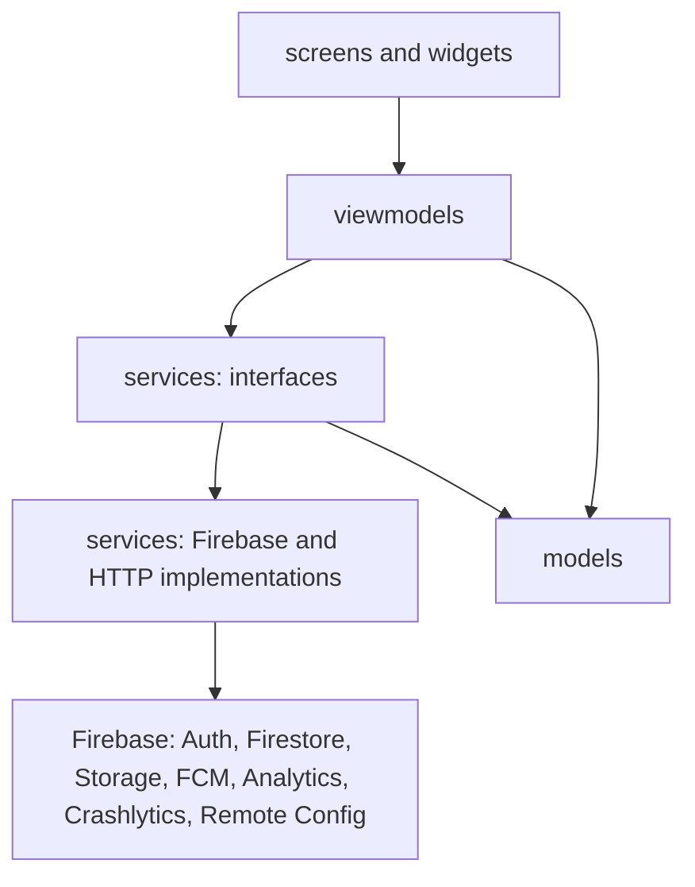
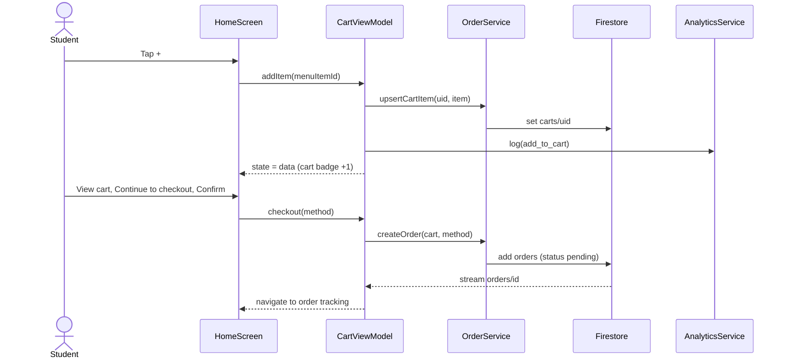

# Architecture

Status: **initial draft**. P1 updates it to match the real code; the submitted version must match the source.

MVVM with Provider or Riverpod (decided when the skeleton was built: `[Provider or Riverpod]`). Dependencies only point downward; a lower layer never imports a higher one.

## 1. Folder structure

| Folder | Role |
|---|---|
| `lib/models/` | Plain data classes, independent of Flutter and Firebase |
| `lib/services/` | Interfaces and implementations for every call to the outside; ViewModels only know the interfaces |
| `lib/firebase/` | Firebase initialization and configuration |
| `lib/viewmodels/` | Screen state (loading, empty, error, data) and business logic |
| `lib/screens/` | Screens, which only display the ViewModel's state |
| `lib/widgets/` | Reusable Lab 2 components that read colors and sizes from the theme |
| `lib/theme/` | Lab 2 tokens turned into `ColorScheme`, `TextTheme`, spacing, radius and shadow constants |
| `lib/utils/` | Pure helpers (money formatting, order status) |
| `lib/router/` | `app_router.dart` (routing by sign-in and role) and `routes_p1..p5.dart`, each person edits their own file |
| `lib/dev/` | Fake services for development and tests; **delete before submitting** |
| `firebase/` | `storage.rules`, `firestore.rules`, `remote-config-defaults.json` |
| `e2e_test/` | The ARTEMIS test suite (Python, pytest) |

## 2. Layer diagram

## 3. Rules (graded)

1. Widgets never call `http`, `FirebaseAuth.instance`, `FirebaseAnalytics.instance` or any other SDK; every outside call goes through a service.
2. Filtering, ranking, aggregation and validation live in a ViewModel or service, not in `build()`.
3. Every screen that loads data has an explicit state model owned by the ViewModel (`sealed class ViewState`: loading, empty, error, data).
4. Services are injected; a ViewModel can be tested with a fake service.
5. No `setState` for shared state; no singleton accessed directly from a widget.

## 4. Sequence diagram: placing an order (F1)

## 5. ViewModels and services (draft)

| ViewModel | Services used |
|---|---|
| `AuthViewModel` | `AuthService`, `AnalyticsService`, `CrashService` |
| `HomeViewModel`, `MenuViewModel`, `SearchViewModel` | `MenuService`, `RemoteConfigService`, `AnalyticsService` |
| `ItemDetailViewModel` | `MenuService`, `AnalyticsService` |
| `CartViewModel`, `VoucherViewModel` | `CartService`, `VoucherService`, `AnalyticsService` |
| `CheckoutViewModel` | `OrderService`, `PaymentSimulatorService`, `AnalyticsService`, `CrashService` |
| `OrderTrackingViewModel`, `OrdersViewModel`, `HistoryViewModel`, `OrderDetailViewModel` | `OrderService` |
| `NotificationCenterViewModel` | `MessagingService`, `NotificationStore` |
| `ProfileViewModel`, `StudentInfoViewModel` | `AuthService`, `UserService` |
| `ReportViewModel` | `ReportService` (generates the PDF), `StorageService`, `AnalyticsService` |
| `SellerOrdersViewModel`, `SellerOrderDetailViewModel`, `ScanViewModel` | `OrderService`, `AuthService` |
| `SellerMenuViewModel`, `MenuItemFormViewModel`, `ShopViewModel`, `ShiftStatsViewModel` | `MenuService`, `KioskService`, `OrderService` |

## 6. Firestore data model

The skeleton is settled and moved to [`docs/data-model.md`](data-model.md): collections, every field, the order lifecycle, queries per screen, indexes, Storage and limitations. Detailed permissions are in `firebase/firestore.rules`, tested by `firebase/tests/rules.test.mjs`.
