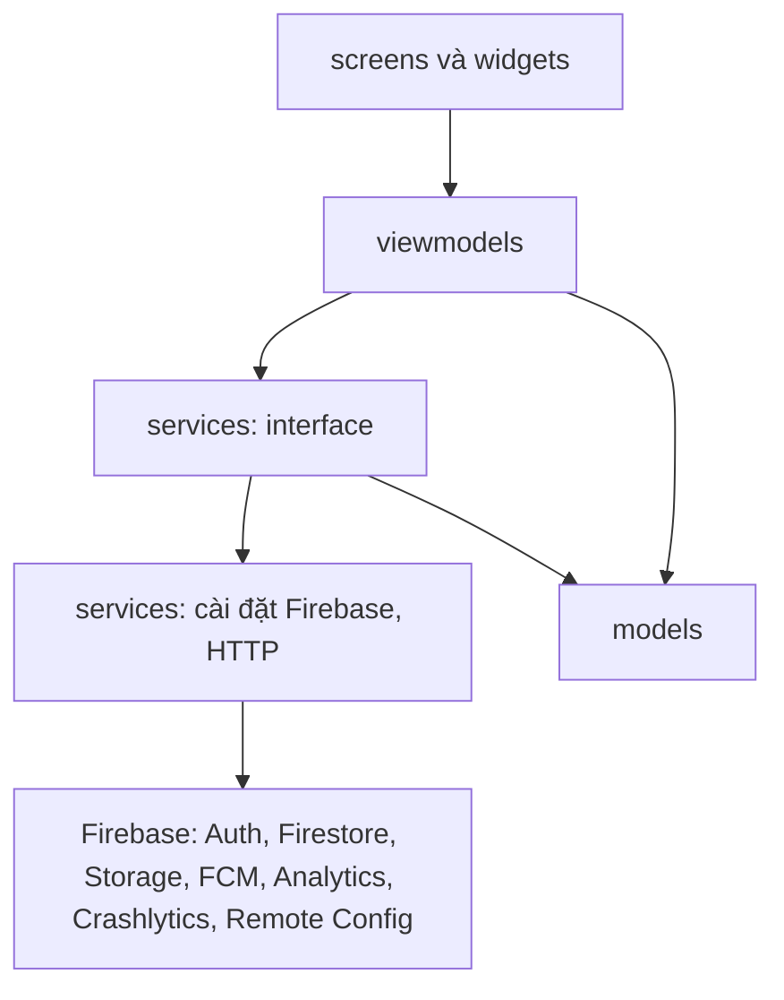
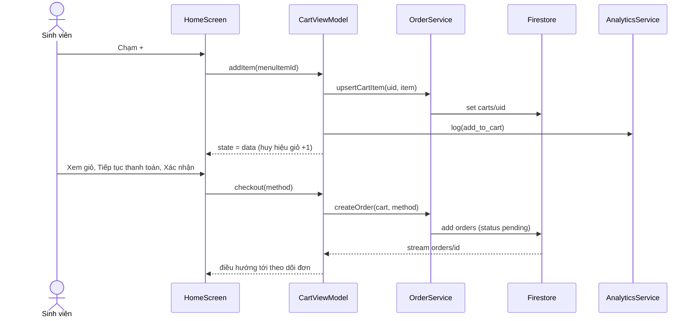

# Kiến trúc

Trạng thái: **bản nháp ban đầu**. P1 cập nhật cho khớp code thật; bản nộp phải trùng với mã nguồn.

MVVM với Provider hoặc Riverpod (chốt khi dựng khung: `[Provider hoặc Riverpod]`). Phụ thuộc chỉ đi xuống, tầng dưới không import tầng trên.

## 1. Cấu trúc thư mục

| Thư mục | Vai trò |
|---|---|
| `lib/models/` | Lớp dữ liệu thuần, không phụ thuộc Flutter hay Firebase |
| `lib/services/` | Interface và cài đặt cho mọi lời gọi ra ngoài; ViewModel chỉ biết interface |
| `lib/firebase/` | Khởi tạo Firebase và cấu hình |
| `lib/viewmodels/` | Trạng thái màn hình (loading, empty, error, data) và logic nghiệp vụ |
| `lib/screens/` | Màn hình, chỉ hiển thị trạng thái của ViewModel |
| `lib/widgets/` | Component Lab 2 dùng lại, đọc màu và kích thước từ theme |
| `lib/theme/` | Token Lab 2 thành `ColorScheme`, `TextTheme`, hằng số khoảng cách, bo góc, đổ bóng |
| `lib/utils/` | Tiện ích thuần (định dạng tiền, trạng thái đơn) |
| `lib/router/` | `app_router.dart` (định tuyến theo đăng nhập và vai trò) và `routes_p1..p4.dart`, mỗi người sửa file của mình |
| `lib/dev/` | Service giả để dev và test; **xoá trước khi nộp** |
| `firebase/` | `storage.rules`, `firestore.rules`, `remote-config-defaults.json` |
| `e2e_test/` | Bộ test ARTEMIS (Python, pytest) |

## 2. Sơ đồ tầng

## 3. Quy tắc (được chấm)

1. Widget không gọi `http`, `FirebaseAuth.instance`, `FirebaseAnalytics.instance` hay SDK khác; mọi lời gọi ngoài đi qua service.
2. Lọc, xếp hạng, tổng hợp, kiểm tra hợp lệ nằm ở ViewModel hoặc service, không nằm trong `build()`.
3. Mỗi màn tải dữ liệu có state model rõ ràng do ViewModel sở hữu (`sealed class ViewState`: loading, empty, error, data).
4. Service được inject; ViewModel kiểm thử được bằng service giả.
5. Không `setState` cho state dùng chung; không singleton truy cập trực tiếp từ widget.

## 4. Sơ đồ tuần tự: đặt món (F1)

## 5. ViewModel và service (bản nháp)

| ViewModel | Service dùng |
|---|---|
| `AuthViewModel` | `AuthService`, `AnalyticsService`, `CrashService` |
| `HomeViewModel`, `MenuViewModel`, `SearchViewModel` | `MenuService`, `RemoteConfigService`, `AnalyticsService` |
| `ItemDetailViewModel` | `MenuService`, `AnalyticsService` |
| `CartViewModel`, `VoucherViewModel` | `CartService`, `VoucherService`, `AnalyticsService` |
| `CheckoutViewModel` | `OrderService`, `PaymentSimulatorService`, `AnalyticsService`, `CrashService` |
| `OrderTrackingViewModel`, `OrdersViewModel`, `HistoryViewModel`, `OrderDetailViewModel` | `OrderService` |
| `NotificationCenterViewModel` | `MessagingService`, `NotificationStore` |
| `ProfileViewModel`, `StudentInfoViewModel` | `AuthService`, `UserService` |
| `ReportViewModel` | `ReportService` (sinh PDF), `StorageService`, `AnalyticsService` |
| `SellerOrdersViewModel`, `SellerOrderDetailViewModel`, `ScanViewModel` | `OrderService`, `AuthService` |
| `SellerMenuViewModel`, `MenuItemFormViewModel`, `ShopViewModel`, `ShiftStatsViewModel` | `MenuService`, `KioskService`, `OrderService` |

## 6. Mô hình dữ liệu Firestore (nháp)

| Collection | Trường chính | Ai ghi |
|---|---|---|
| `users/{uid}` | `role` (user, staff, admin), `displayName` | Chính chủ khi đăng nhập lần đầu (role = user); chỉ admin đổi role |
| `menu_items/{id}` | `name`, `priceVnd`, `category`, `soldOut`, `prepMinutes` | Staff |
| `kiosks/{id}` | `name` (Q9 tầng 2, tầng 4, Nhà văn hóa SV), `open`, `waitMinutes` | Staff |
| `vouchers/{code}` | `discountVnd`, `expiresAt`, `minOrderVnd` | Staff |
| `carts/{uid}` | `items[]` | Chính chủ |
| `orders/{id}` | `uid`, `items[]`, `totalVnd`, `paymentMethod`, `status` (pending, preparing, ready, delivered, cancelled), `kioskId` | Khách tạo; staff đổi trạng thái |
| `users/{uid}/favorites`, `users/{uid}/notifications` | | Chính chủ |
| `reviews`, `incidents` | `orderId`, `uid`, nội dung | Khách tạo; staff đọc |

Trạng thái và quyền chi tiết viết lại ở `firebase/firestore.rules`; kiểm thử trong Emulator.
