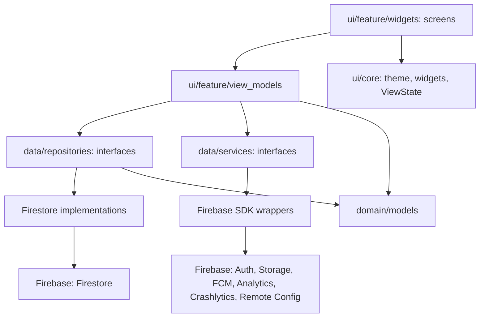
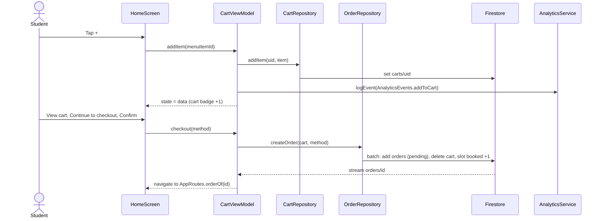

# Architecture

MVVM with Provider and go_router, following the official Flutter architecture guide ([docs.flutter.dev/app-architecture](https://docs.flutter.dev/app-architecture)): a **UI layer** (views and view models, grouped by feature) on top of a **data layer** (repositories and services, grouped by type). Dependencies only point downward; a lower layer never imports a higher one.

## 1. Folder structure

```
lib/
  main.dart                     entry point with real Firebase
  app.dart                      MaterialApp, providers, router
  firebase_options.dart         generated by flutterfire configure
  config/
    dependencies.dart           AppDependencies: every service and repository, exposed one by one through Provider
    firebase_dependencies.dart  builds the Firebase implementations (P3, T22 and T33)
  routing/
    router.dart                 GoRouter, redirect by sign-in and role, tab shells
    routes.dart                 AppRoutes: every path as a constant
    routes_p1.dart … routes_p5.dart   each owner wires their own screens here
  domain/models/                plain data classes, one file per model, models.dart exports them all
  data/
    services/                   thin wrappers around an SDK: auth, analytics, crash, messaging, storage, remote config
    repositories/               source of truth for business data (Firestore): menu, cart, order…
  ui/
    core/                       theme/, widgets/, view_state.dart, placeholder_screen.dart (shared, owned by P1)
    <feature>/
      view_models/              <feature>_view_model.dart
      widgets/                  <feature>_screen.dart and widgets used only by this feature
  utils/                        pure helpers (money formatting)
dev/                            OUTSIDE lib/: never part of the submitted build
  main_dev.dart                 entry point with fake data
  fake_dependencies.dart        createFakeDependencies()
  fakes/                        in-memory fakes of every service and repository, also used by tests
test/                           mirrors lib/ (test/ui/home/…, test/routing/…)
```

## 2. Layers



| Layer | Responsibility | Knows about |
|---|---|---|
| Screen (`ui/<feature>/widgets/`) | Draws the ViewModel's state, forwards taps | Its ViewModel, `ui/core`, `AppRoutes` |
| ViewModel (`ui/<feature>/view_models/`) | Screen state (`ViewState`), filtering, validation, calls to repositories and services | Repository and service **interfaces**, models |
| Repository (`data/repositories/`) | Reads and writes business data, turns documents into models, hides queries | Models, Firestore (in its implementation only) |
| Service (`data/services/`) | Wraps one external SDK, holds no business data | The SDK (in its implementation only) |
| Model (`domain/models/`) | Immutable data and pure rules (for example `Voucher.discountFor`) | Nothing |

## 3. Rules (graded)

1. Screens and ViewModels never import `package:firebase_*`, `package:cloud_firestore` or `http`; only implementations under `lib/data/` and `lib/config/` may.
2. Filtering, ranking, aggregation and validation live in a ViewModel or repository, not in `build()`.
3. Every screen that loads data has an explicit state model owned by the ViewModel (`sealed class ViewState`: loading, empty, error, data).
4. Repositories and services are injected through the constructor; a ViewModel can be tested with a fake from `dev/fakes/`.
5. No `setState` for shared state; no singleton accessed directly from a widget.
6. Paths come from `AppRoutes`, analytics event names from `AnalyticsEvents`, spacing from `AppSpacing` (names match the Figma tokens), never typed by hand.
7. `lib/` never imports `dev/`. The submitted build therefore contains no fake data.

## 4. Sequence diagram: placing an order (F1)



## 5. Features, owners, ViewModels and dependencies

One folder per feature under `lib/ui/`; the owner creates it when building the first screen.

| Folder `lib/ui/…` | Screens | Owner | ViewModel | Depends on |
|---|---|---|---|---|
| `onboarding/` | S01 | P1 | (uses `AuthViewModel`) | — |
| `home/` | S02, S21 | P1 | `HomeViewModel` | `MenuRepository`, `CartRepository`, `OrderRepository`, `RemoteConfigService`, `AnalyticsService` |
| `menu/` | S03, S04, S22 | P1 | `MenuViewModel`, `ItemDetailViewModel`, `AlternativesViewModel` | `MenuRepository`, `CartRepository`, `AnalyticsService` |
| `cart/` | S05, S25, S29 | P1 | `CartViewModel`, `PickupTimeViewModel`, `VoucherViewModel` | `CartRepository`, `SlotRepository`, `VoucherRepository`, `AnalyticsService` |
| `checkout/` | S06, S06-GATEWAY | P1 | `CheckoutViewModel` | `OrderRepository`, `CartRepository`, `AnalyticsService`, `CrashService` |
| `orders/` | S07, S08 | P1 | `OrderTrackingViewModel`, `OrdersViewModel` | `OrderRepository` |
| `order_manage/` | S09, S10, S12, S20 | P2 | `EditOrderViewModel`, `OrderDetailViewModel`, `PickupViewModel` | `OrderRepository`, `StorageService` (PDF, T43) |
| `history/` | S11 | P2 | `HistoryViewModel` | `OrderRepository` |
| `review/`, `incident/` | S23, S24 | P2 | `ReviewViewModel`, `IncidentViewModel` | `ReviewRepository`, `IncidentRepository`, `StorageService` |
| `seller_menu/` | K08, K09, K14, K15 | P2 | `SellerMenuViewModel`, `MenuItemFormViewModel` | `MenuRepository`, `StorageService` |
| `seller_shop/` | K10, K11 | P2 | `ShopViewModel`, `ShiftStatsViewModel` | `MenuRepository` (kiosks), `OrderRepository` |
| `auth/` | S26 | P3 | `AuthViewModel` (app-wide) | `AuthService`, `AnalyticsService`, `CrashService` |
| `profile/` | S15, S16, S17, Firebase demo | P3 | `ProfileViewModel`, `PaymentSettingsViewModel`, `FirebaseDemoViewModel` | `AuthService`, `UserRepository`, `RemoteConfigService`, `CrashService`, `StorageService` |
| `kiosk_picker/` | S27 | P3 | `KioskViewModel` | `MenuRepository` (kiosks) |
| `seller_orders/` | K01–K06, K12 | P4 | `SellerOrdersViewModel`, `SellerOrderDetailViewModel`, `ScanViewModel` | `OrderRepository`, `AuthService` |
| `seller_incidents/` | K13 | P4 | `IncidentsViewModel` | `IncidentRepository` |
| `favorites/`, `reorder/` | S13, S14 | P5 | `FavoritesViewModel`, `ReorderViewModel` | `FavoriteRepository`, `OrderRepository`, `CartRepository` |
| `notifications/` | S18, S19 | P5 | `NotificationSettingsViewModel`, `NotificationCenterViewModel` | `NotificationRepository`, `MessagingService` |
| `search/`, `offline/` | S28, S30 | P5 | `SearchViewModel`, `ConnectivityViewModel` | `MenuRepository` |

Repositories that do not exist yet (task T34) are created by the feature owner: `SlotRepository`, `VoucherRepository` (P1), `ReviewRepository`, `IncidentRepository` create side (P2), `IncidentRepository` handling side (P4), `FavoriteRepository`, `NotificationRepository` (P5), `UserRepository` (P3).

## 6. Adding a repository or service

1. Interface in its own file: `lib/data/repositories/<name>_repository.dart` (or `lib/data/services/<name>_service.dart`), one export line in `repositories.dart` (or `services.dart`).
2. Fake in `dev/fakes/fake_<name>_repository.dart`, one export line in `dev/fakes/fakes.dart`.
3. Firestore implementation in `lib/data/repositories/firestore/firestore_<name>_repository.dart` (services: `lib/data/services/firebase/firebase_<name>_service.dart`).
4. One field in `AppDependencies` plus one line in its `providers`, one line in `createFakeDependencies` and one in `createFirebaseDependencies`.
5. The route that builds a ViewModel reads it with `context.read<NameRepository>()`.

## 7. Firestore data model

Collections, every field, the order lifecycle, queries per screen, indexes, Storage and limitations: [`docs/data-model.md`](data-model.md). Detailed permissions are in `firebase/firestore.rules`, tested by `firebase/tests/rules.test.mjs`.
