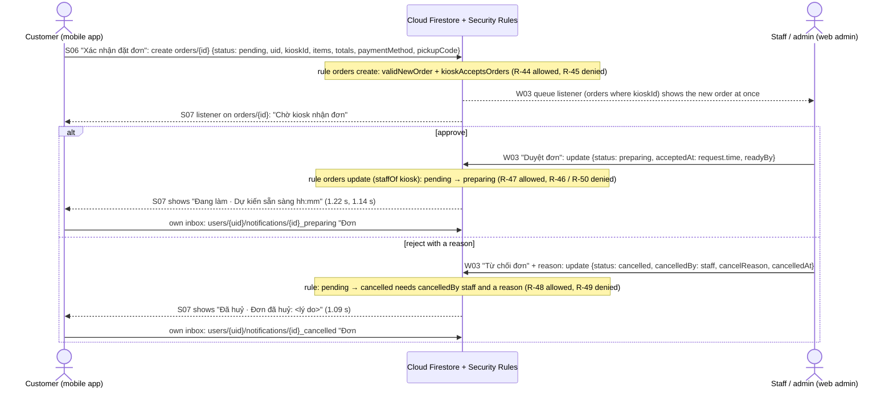
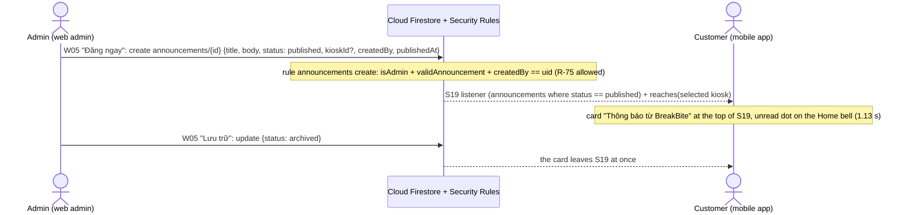

# Cross-role flows

Final assignment, handout section 3 ("at least one flow must cross roles and clients") and Appendix C. Two flows
cross roles and clients through Firestore alone. There is no server and no Cloud Function: each client writes, the
Security Rules decide, and the other client's snapshot listener shows the change.

| Flow | Roles and clients | Firestore | Measured (web write → phone shows it) |
|---|---|---|---|
| **1. Order review**: a customer orders on the phone, staff approve or reject it on the web, the phone updates and the inbox gets a message | customer (mobile) → staff or admin (web) → customer (mobile) | `orders/{id}`, `users/{uid}/notifications/{id}` | 1.22 s, 1.09 s, 1.14 s (mean 1.15 s, 3 runs) |
| **2. Announcement**: an admin publishes on the web, the customer's inbox shows it; archiving removes it | admin (web) → customer (mobile) | `announcements/{id}` | publish 1.13 s, archive 0.81 s |

Both were run on the **deployed system** on 12/11/2026: the web admin at https://breakbite-1315b.web.app (signed in
as an admin), the real Firebase project `breakbite-1315b`, and the mobile app on the Android emulator `BB_Pixel7`
signed in as a customer, with Kiosk Q9 · Tầng 2.

## 1. Order review

| # | Actor and client | Screen | Firestore write (collection, fields) | Rule that allows it (test) | What the other client shows |
|---|---|---|---|---|---|
| 1 | Customer, mobile | S05 cart → S06 checkout → "Xác nhận đặt đơn" | `orders/{id}` create: `status: pending`, `uid`, `customerName`, `kioskId`, `items`, `subtotalVnd`, `discountVnd`, `totalVnd`, `paymentMethod`, `paymentStatus` (`unpaid` for cash), `pickupCode`, `createdAt`, `updatedAt` (one transaction that also empties `carts/{uid}`) | `orders` create: signed in, `validNewOrder` (owner, `pending`, totals add up, voucher discount recomputed), `kioskAcceptsOrders` (open, not paused) — R-44 allowed, R-45 (create as `preparing`) denied | Web W03 "Duyệt đơn": the order appears in the queue at once ("11 chờ duyệt"), oldest first |
| 2a | Staff or admin, web | W03, choose the time ("10 phút"), "Duyệt đơn · xong sau 10 phút" | `orders/{id}` update: `status: preparing`, `acceptedAt` (server time), `readyBy`, `updatedAt` | `orders` update by `staffOf(kioskId)`: only operating fields change, `pending → preparing` is a valid transition, `acceptedAt == request.time`, `readyBy` in the future — R-47 allowed; R-46 (the customer approves) and R-50 (staff of another kiosk) denied | Phone S07: step 2 "Đang làm" and "Dự kiến sẵn sàng 00:01 (còn 9 phút)"; then the inbox (S19) and the Home bell dot: "Đơn #QLOTIR đang được làm" |
| 2b | Staff or admin, web | W03 "Từ chối đơn", pick a reason (Remote Config `reject_reasons`) or type one, "Từ chối đơn" | `orders/{id}` update: `status: cancelled`, `cancelledBy: staff`, `cancelReason`, `cancelledAt`, `updatedAt` | Same staff rule: `pending → cancelled` only with `cancelledBy == 'staff'` and a string reason, `cancelledAt == request.time` — R-48 allowed, R-49 (no reason) denied | Phone S07: "Đã huỷ" and "Đơn đã huỷ: Quầy sắp đóng cửa"; inbox: "Đơn #25RPEH bị từ chối · Lý do: Quầy sắp đóng cửa. Đơn trả tại quầy nên bạn không mất tiền." |
| 3 | Customer, mobile (automatic) | `OrderStatusNotifier` while the customer is signed in | `users/{uid}/notifications/{orderId}_{status}` create: `title`, `body`, `orderId`, `read: false`, `createdAt` (written with `set` and a fixed id, so the same change seen twice stays one message) | `notifications` create by the owner only — R-07 (read own) and R-09 (create own) allowed, R-08 (another user's inbox) and R-10 (staff writing into a customer inbox) denied | — (the customer's own inbox) |

## 2. Announcement (second cross-role flow)

| # | Actor and client | Screen | Firestore write | Rule (test) | What the other client shows |
|---|---|---|---|---|---|
| 1 | Admin, web | W05 "Thông báo mới": title, body, "Gửi tới" (every kiosk or one kiosk), "Đăng ngay" | `announcements/{id}` create: `title` (≤ 120), `body` (≤ 1000), `status: published`, `kioskId` (optional), `createdBy`, `publishedAt`, `createdAt`, `updatedAt` | `announcements` create: `isAdmin()`, `validAnnouncement` (keys and lengths), `createdBy == request.auth.uid` — R-75 allowed; staff and customers cannot write; R-80 (delete) denied | Phone S19: the card "Thông báo từ BreakBite · Kiosk Q9 · Tầng 2 mở tới 23:59 hôm nay" at the top, unread |
| 2 | Customer, mobile | S19, tap the card | `users/{uid}/notifications/ann_{id}` create, then `read: true` (the read flag only; the text always comes from the announcement) | `notifications`, owner only (R-07, R-09) | — |
| 3 | Admin, web | W05 list, "Lưu trữ" | `announcements/{id}` update: `status: archived` | `announcements` update: `isAdmin()`, `createdBy` unchanged | The card leaves S19 (0.81 s; `AnnouncementInboxRepository` only shows published announcements that reach the chosen kiosk) |

Customers read only published announcements (R-71 allowed, R-72 draft denied); the S19 query asks for
`status == published`, so it matches the rule.

## 3. Measured times

**Method.** The phone screen was recorded with `adb shell screenrecord --bugreport`, which stamps the device time on
every frame and only writes a frame when the screen changes, so the first changed frame is the moment the phone drew
the update. The web click time is the browser's `Date.now()` taken around the click (the click itself takes 40–130 ms).
The emulator clock was compared with the host clock by 15 to 20 `adb shell date` round trips, keeping the one with
the shortest round trip (about 0.05 s): the emulator was 0.472–0.474 s ahead, so each click time was moved onto the
phone's clock before subtracting; the offset was measured again right after each run. Uncertainty: about ±0.05 s. For
the archive the emulator clock had moved by about 1.5 s since the order runs (offset −1.024 s, measured a minute after
the click), so that figure is less certain.

| Run | Order (placed) | Web action | Click (phone clock) | Phone shows it | Time | Evidence |
|---|---|---|---|---|---|---|
| 1 | #QLOTIR, Bánh Mì Chả Lụa Trứng, cash (23:50) | Approve, 10 phút | 23:51:49.133 | 23:51:50.353 "Đang làm · Dự kiến sẵn sàng 00:01 (còn 9 phút)" | **1.22 s** | `run1-approve-phone.mp4`, `run1-phone-before/after.png`, `run1-web-before/after.png` |
| 2 | #25RPEH, Cà Phê Sữa Đá, cash (23:54) | Reject, "Quầy sắp đóng cửa" | 23:55:20.885 | 23:55:21.976 "Đã huỷ · Đơn đã huỷ: Quầy sắp đóng cửa" | **1.09 s** | `run2-reject-phone.mp4`, `run2-phone-before/after.png`, `run2-web-before/after.png` |
| 3 | #S7SWIR, Combo Tacos Bò Phô Mai, cash (23:56) | Approve, 15 phút | 23:57:46.341 | 23:57:47.481 "Đang làm · Dự kiến sẵn sàng 00:12 (còn 14 phút)" | **1.14 s** | `run3-approve-phone.mp4`, `run3-phone-before/after.png`, `run3-web-before/after.png` |
| Flow 2 | Announcement "Kiosk Q9 · Tầng 2 mở tới 23:59 hôm nay", every kiosk | Publish | 23:59:43.443 | 23:59:44.577 card at the top of S19 | **1.13 s** | `announcement-phone.mp4`, `announcement-phone-before/after.png`, `announcement-web-before/after.png` |
| Flow 2 | The same announcement | Archive ("Lưu trữ") | 00:17:30.587 | 00:17:31.402 the card is gone | **0.81 s** (less certain, see above) | `announcement-archive-phone.mp4`, `announcement-archive-phone-before/after.png`, `announcement-archived-web.png` |

All files are in [`evidence/cross-role/`](../evidence/cross-role/); the raw numbers are in
[`measurements.json`](../evidence/cross-role/measurements.json). After the three runs the inbox held the three
messages ([`inbox-after-3-runs.png`](../evidence/cross-role/inbox-after-3-runs.png)). The new order also appeared in
the web queue as soon as it was placed (run 1: "11 chờ duyệt", [`W03-selected-QLOTIR.png`](../evidence/web/W03-selected-QLOTIR.png)).

## 4. What the runs found

| Found | Problem | Fix |
|---|---|---|
| Run 2 | The rejected order was paid in cash at the counter (unpaid), yet the inbox said "Bạn được hoàn tiền"; the seller app's reject dialog said the same | The text now depends on `paymentStatus` ([PR #114](https://github.com/baonv0817/PRM393_Lab03_Group2/pull/114)) |
| Before run 1 | Kiosk Q9 · Tầng 2 was "Ngoài giờ mở cửa" at 23:47 (hours 06:30–17:00, D35), so the customer could not order | Closing time set to 23:59 in K10 for the runs; set the hours to cover the demo before recording (gap G03) |
| Web checklist, same evening | An admin who switched kiosk while W03 was open kept the previous kiosk's queue | Fixed in [PR #111](https://github.com/baonv0817/PRM393_Lab03_Group2/pull/111) before the runs |

## 5. Run it again

1. Web: https://breakbite-1315b.web.app, sign in with a staff account of the kiosk or an admin; open "Duyệt đơn".
2. Phone: sign in with a customer account, choose the same kiosk (it must be open: K10 hours and "Đang nhận đơn").
3. Phone: add an item, "Tiếp tục thanh toán", "Tiền mặt tại kiosk", "Xác nhận đặt đơn"; keep S07 open.
4. Web: the order appears at the bottom of the queue; select it and "Duyệt đơn" (or "Từ chối đơn" with a reason).
5. Phone: S07 changes within about a second; the bell on Home gets a dot and S19 has the message.
6. Web, as admin: "Thông báo", write a title and body, "Đăng ngay"; the phone's S19 shows it at the top.

To time it again: `adb shell screenrecord --bugreport --time-limit 25 /sdcard/run.mp4` before the click, then read the
time stamped on the first frame that changed.
