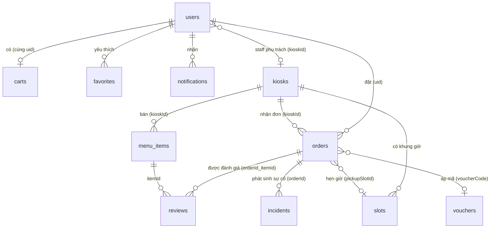
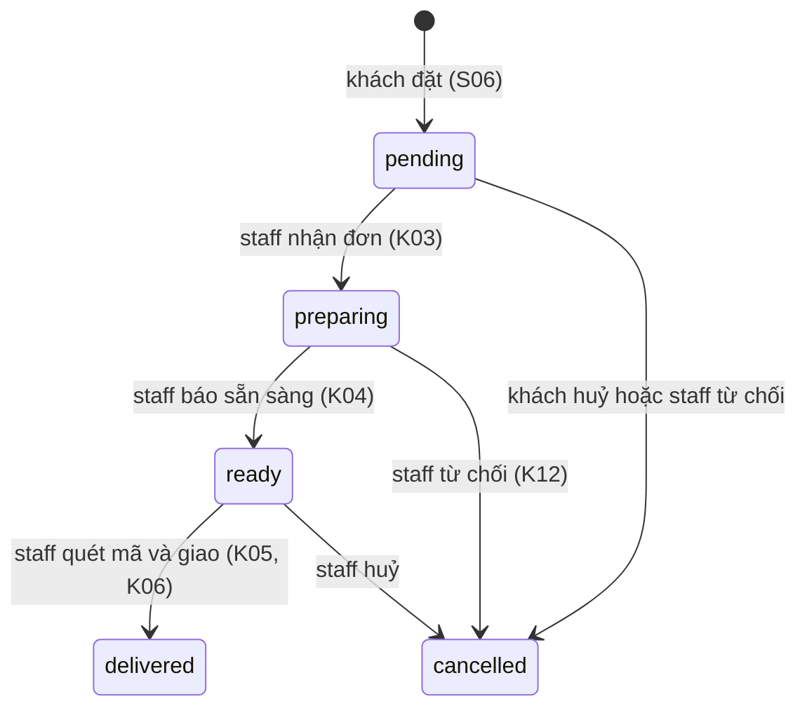

# Mô hình dữ liệu Firestore và Storage

Tài liệu gốc cho dữ liệu của app khách (S01–S30) và app người bán (K01–K15). Mọi thay đổi cấu trúc dữ liệu phải sửa **cả bốn nơi trong cùng một PR**: tài liệu này, `lib/models/models.dart`, `firebase/firestore.rules` (và `storage.rules`), `firebase/tests/rules.test.mjs`. Người giữ tài liệu: P3.

Project Firebase: `breakbite-1315b`, Firestore `(default)`, vùng `asia-southeast1`.

## 1. Nguyên tắc thiết kế

| Nguyên tắc | Áp dụng |
|---|---|
| **Thiết kế theo truy vấn**, không theo bảng | Mỗi màn có truy vấn nêu ở mục 5; trường nào dùng để lọc hay sắp xếp đều có chỉ mục |
| **Ảnh chụp (snapshot) trong đơn** | Đơn lưu sẵn tên món, giá, tên kiosk, tên khách tại lúc đặt. Món đổi giá hay kiosk đổi tên sau này **không** làm sai đơn cũ |
| **Nhúng khi nhỏ và luôn đọc cùng nhau** | `items[]` nằm trong `carts/{uid}` và `orders/{id}` (tối đa 30 dòng, rất nhỏ so với giới hạn 1 MiB của một tài liệu) |
| **Tách subcollection khi tập hợp tăng dần** | `favorites`, `notifications`, `slots` |
| **Một kiosk, một thực đơn** | Mỗi `menu_items` thuộc đúng một `kioskId`; muốn bán ở 3 kiosk thì có 3 tài liệu (script nạp dữ liệu sinh ra). Món hết hàng là việc của từng quầy |
| **Tiền là số nguyên VND** | `priceVnd`, `totalVnd`… kiểu `int`, không dùng số thực |
| **Giờ là `Timestamp` do máy chủ đặt** | Khi tạo, dùng `FieldValue.serverTimestamp()`; rules kiểm `createdAt == request.time` nên khách không giả được giờ |
| **Không xoá cứng** | Đơn, món, kiosk, đánh giá, sự cố không xoá được (`delete: false`). Món dùng `soldOut`, đơn dùng `status: cancelled` |
| **Quyền theo vai trò và theo kiosk** | `user`, `staff`, `admin`; nhân viên chỉ thao tác trên kiosk của mình (`users/{uid}.kioskId`) |

## 2. Sơ đồ quan hệ

Đường dẫn đầy đủ: `users/{uid}`, `users/{uid}/favorites/{itemId}`, `users/{uid}/notifications/{id}`, `kiosks/{kioskId}`, `kiosks/{kioskId}/slots/{slotId}`, `menu_items/{id}`, `vouchers/{code}`, `carts/{uid}`, `orders/{id}`, `reviews/{orderId}_{itemId}`, `incidents/{id}`.

## 3. Chi tiết từng collection

Kiểu: `string`, `int`, `bool`, `ts` (Timestamp), `list`, `map`. Cột **Ghi** là ai được tạo hoặc sửa (rules chặn người khác). `?` là trường có thể vắng.

### 3.1 `users/{uid}`

Id là uid của Firebase Auth. Tạo ở lần đăng nhập Google đầu tiên (T30).

| Trường | Kiểu | Ghi | Ghi chú |
|---|---|---|---|
| `displayName` | string | chủ | Lấy từ tài khoản Google, sửa được ở S16 |
| `email` | string | chủ | Chỉ chủ và admin đọc được hồ sơ |
| `photoUrl` | string? | chủ | |
| `role` | string | tạo: `user`; đổi: admin | `user`, `staff`, `admin`. Khách **không** tự đổi |
| `kioskId` | string? | admin | Chỉ staff có; staff mới tạo xong chưa gán kiosk thì chưa xử lý được gì |
| `studentId` | string? | chủ | MSSV (S16) |
| `defaultPaymentMethod` | string? | chủ | `momo`, `vnpay`, `card`, `cash` (S17) |
| `notificationPrefs` | map? | chủ | `{orderStatus: bool, promo: bool}` (S18) |
| `fcmTokens` | list<string>? | chủ | Token FCM các thiết bị |
| `createdAt`, `lastLoginAt` | ts | chủ | |

Subcollection (chỉ chủ đọc ghi):
- `favorites/{itemId}`: `itemId`, `kioskId`, `name`, `priceVnd`, `imageUrl?`, `addedAt` (snapshot để hiện danh sách mà không phải đọc thêm món).
- `notifications/{id}`: `title`, `body`, `orderId?`, `read`, `createdAt`. App khách tự ghi khi thấy trạng thái đơn đổi (không cần máy chủ); tin đẩy FCM gửi riêng từ console.

### 3.2 `kiosks/{kioskId}`

Id đề xuất: `q9-t2` (Campus Q9, tầng 2), `q9-t4` (Campus Q9, tầng 4), `nvh-t1` (Nhà văn hóa SV, tầng 1).

| Trường | Kiểu | Ghi | Ghi chú |
|---|---|---|---|
| `name` | string | admin tạo; staff sửa | "Kiosk Q9 · Tầng 2" |
| `location` | string | staff | "Campus Q9, tầng 2" |
| `open` | bool | staff | Quán đóng thì khách **không đặt được** (rules kiểm) |
| `waitMinutes` | int | staff | Thời gian chờ ước tính (S02, S27) |
| `openTime`, `closeTime` | string? | staff | "06:30", "17:00" |
| `notice` | string? | staff | Hiện ở Trang chủ khi đóng cửa (S21) |
| `updatedAt` | ts | staff | |

`kiosks/{kioskId}/slots/{slotId}`: khung giờ nhận món (S25). Id dạng `20261029-0950`.

| Trường | Kiểu | Ghi | Ghi chú |
|---|---|---|---|
| `startAt`, `endAt` | ts | staff | Mỗi khung ứng với giờ ra chơi 15 phút giữa hai slot học |
| `capacity` | int | staff | Số đơn tối đa |
| `booked` | int | staff, và **khách ±1** | Khách đặt: `+1`, huỷ: `−1`, trong `[0, capacity]` (rules kiểm). Đặt đơn và tăng `booked` làm trong một **batch** để không lệch |

Slot do staff hoặc script nạp tạo cho từng ngày. Không có slot thì đơn nhận "ngay khi xong" (`pickupSlotId` vắng).

### 3.3 `menu_items/{id}`

| Trường | Kiểu | Ghi | Ghi chú |
|---|---|---|---|
| `kioskId` | string | staff | Không đổi được sau khi tạo |
| `name` | string | staff | Không rỗng |
| `searchName` | string | staff | Tên không dấu, chữ thường, để tìm kiếm (S28). Ví dụ "combo tacos bo pho mai" |
| `description` | string | staff | |
| `priceVnd` | int | staff | > 0 |
| `category` | string | staff | "Tacos", "Mì trộn", "Đồ uống" |
| `prepMinutes` | int | staff | ≥ 0; mục "nhanh dưới 5 phút" lọc `prepMinutes <= 5` |
| `soldOut` | bool | staff | Món hết (K09); thay cho xoá |
| `imageUrl` | string? | staff | Ảnh trong Storage `menu/{kioskId}/…` hoặc ảnh có sẵn trong app |
| `createdAt`, `updatedAt` | ts | staff | |

Điểm sao trung bình tính ở máy khách từ `reviews` (không lưu tổng hợp vì khách không được sửa món).

### 3.4 `vouchers/{code}`

Id là mã viết hoa (`BBSTUDENT`). Chỉ admin tạo và sửa.

| Trường | Kiểu | Ghi chú |
|---|---|---|
| `title` | string | "Giảm 10K cho sinh viên" |
| `discountVnd` | int | Giảm cố định |
| `percent` | int? | Nếu có thì giảm theo %, có trần `maxDiscountVnd` |
| `maxDiscountVnd` | int? | |
| `minOrderVnd` | int | Đơn tối thiểu |
| `expiresAt` | ts | Hết hạn thì báo lỗi ở S05-VOUCHER-ERR |
| `active` | bool | Tắt mã mà không xoá |

Tính tiền giảm: `Voucher.discountFor()` trong `models.dart` (có test).

### 3.5 `carts/{uid}`

Mỗi người một giỏ, id = uid. Giỏ gắn với **một kiosk**: đổi kiosk thì hỏi xoá giỏ.

| Trường | Kiểu | Ghi chú |
|---|---|---|
| `kioskId` | string | |
| `items` | list<map> | Tối đa 30 dòng. Mỗi dòng: `itemId`, `name`, `priceVnd`, `quantity`, `note` |
| `voucherCode` | string? | Mã đang áp |
| `updatedAt` | ts | |

### 3.6 `orders/{id}`

Id tự sinh. Đây là collection trung tâm.

| Trường | Kiểu | Ghi | Ghi chú |
|---|---|---|---|
| `orderCode` | string | khách khi tạo | 6 ký tự đầu của id, viết hoa; hiện cho khách và nhân viên |
| `uid` | string | khách khi tạo | Không đổi được |
| `customerName` | string | khách khi tạo | Snapshot, để quầy không cần đọc `users` |
| `kioskId`, `kioskName` | string | khách khi tạo | `kioskId` không đổi được; quầy phải mở cửa |
| `items` | list<map> | khách (khi pending) | Snapshot: `itemId`, `name`, `priceVnd`, `quantity`, `note` |
| `subtotalVnd` | int | khách | Tổng tiền món |
| `discountVnd` | int | khách | 0 ≤ discount ≤ subtotal |
| `totalVnd` | int | khách | **Phải bằng** `subtotalVnd − discountVnd` (rules kiểm) |
| `voucherCode` | string? | khách | |
| `paymentMethod` | string | khách khi tạo | `momo`, `vnpay`, `card`, `cash`. **Không đổi** sau khi đặt |
| `paymentStatus` | string | khách khi tạo; staff chỉ `unpaid → paid` | Cổng mô phỏng: `paid`. Tiền mặt: `unpaid` đến khi thu |
| `status` | string | xem mục 4 | `pending`, `preparing`, `ready`, `delivered`, `cancelled` |
| `pickupSlotId` | string? | khách | Khung giờ đã hẹn |
| `pickupAt` | ts? | khách | Giờ bắt đầu khung giờ |
| `pickupCode` | string | khách khi tạo | 6 chữ số ngẫu nhiên. **Mã QR** = `bb:<id>:<pickupCode>`; không đổi được |
| `note` | string? | khách | Ghi chú chung cho cả đơn |
| `cancelReason`, `cancelledBy` | string? | khách hoặc staff | `cancelledBy`: `customer` hoặc `staff`; staff từ chối **bắt buộc có lý do** |
| `createdAt` | ts | máy chủ | |
| `acceptedAt`, `readyAt`, `deliveredAt`, `cancelledAt` | ts? | staff / khách | Mốc thời gian từng bước (K11 tính thời gian xử lý) |
| `updatedAt` | ts | ai sửa | |

## 4. Vòng đời đơn

| Ai | Được làm | Điều kiện (rules kiểm) |
|---|---|---|
| Khách | Tạo đơn `pending` | Quầy `open`, tổng khớp, tiền mặt thì `unpaid`, `createdAt` là giờ máy chủ |
| Khách | Sửa món, giờ hẹn, ghi chú (S09) hoặc huỷ (S07-DIALOG) | Chỉ khi `pending`; huỷ thì `cancelledBy = customer` |
| Staff | Chuyển đúng bước kế tiếp | Không nhảy bước, không lùi, đúng kiosk của mình |
| Staff | Giao đơn tiền mặt | Phải ghi `paymentStatus = paid` cùng lúc (K06-CASH) |
| Staff | Từ chối | `cancelledBy = staff` và có `cancelReason` |
| Admin | Như staff, mọi kiosk | |
| Không ai | Xoá đơn | |

### Đặt đơn bằng một batch

Khi khách xác nhận (S06), app ghi **trong một `WriteBatch`**: tạo `orders/{id}` + xoá `carts/{uid}` + (nếu hẹn giờ) `slots/{slotId}.booked + 1`. Batch thất bại thì không ghi gì, nên không có đơn mà giỏ vẫn còn hoặc ngược lại. Huỷ đơn có hẹn giờ: batch cập nhật đơn + `booked − 1`.

## 5. Truy vấn theo màn hình và chỉ mục

Mọi chỉ mục tổng hợp nằm trong `firebase/firestore.indexes.json` (đã đẩy lên project). Chỉ mục một trường Firestore tự tạo.

| Màn | Truy vấn | Chỉ mục |
|---|---|---|
| S27 Chọn kiosk | `kiosks` | tự động |
| S02, S03 Thực đơn | `menu_items` where `kioskId == k` orderBy `name` | (kioskId, name) |
| S03 lọc theo loại | `menu_items` where `kioskId == k` and `category == c` orderBy `name` | (kioskId, category, name) |
| S02 "nhanh dưới 5 phút" | `menu_items` where `kioskId == k` and `prepMinutes <= 5` orderBy `prepMinutes` limit `quick_items_limit` | (kioskId, prepMinutes) |
| S28 Tìm kiếm | `menu_items` where `kioskId == k` and `searchName >= q` and `searchName < q + ''` | (kioskId, searchName) |
| S04 Chi tiết, S22 Gợi ý thay thế | `menu_items/{id}`; gợi ý: cùng `kioskId` và `category`, `soldOut == false` | tự động |
| S05 Giỏ hàng | `carts/{uid}` (lắng nghe) | — |
| S29 Chọn mã | `vouchers` where `active == true` | tự động |
| S25 Hẹn giờ | `kiosks/{k}/slots` where `startAt >= now` orderBy `startAt` | tự động |
| S07 Theo dõi | `orders/{id}` (lắng nghe) | — |
| S08, S11, S14 Lịch sử, đặt lại | `orders` where `uid == me` orderBy `createdAt desc` | (uid, createdAt desc) |
| S13 Yêu thích | `users/{uid}/favorites` orderBy `addedAt desc` | tự động |
| S19 Thông báo | `users/{uid}/notifications` orderBy `createdAt desc` | tự động |
| S23 Đánh giá | `reviews/{orderId}_{itemId}`; xem đánh giá món: `reviews` where `itemId == m` orderBy `createdAt desc` | (itemId, createdAt desc) |
| S24 Báo sự cố | tạo `incidents`; khách xem: where `uid == me` orderBy `createdAt desc` | (uid, createdAt desc) |
| K02 Hàng đợi đơn | `orders` where `kioskId == mine` and `status in [pending, preparing, ready]` orderBy `createdAt desc` | (kioskId, status, createdAt desc) |
| K05 Quét mã | `orders` where `kioskId == mine` and `pickupCode == c` and `status == 'ready'` | (kioskId, pickupCode, status) |
| K08 Quản lý món | như S03, không lọc `soldOut` | (kioskId, name) |
| K11 Thống kê ca | `orders` where `kioskId == mine` and `createdAt >= startOfShift`, dùng `count()` và `sum(totalVnd)` | (kioskId, createdAt desc) |
| K13 Sự cố từ khách | `incidents` where `kioskId == mine` and `status == s` orderBy `createdAt desc` | (kioskId, status, createdAt desc) |

**Lưu ý về rules và truy vấn.** Rules không phải bộ lọc: truy vấn của nhân viên **phải có** `where('kioskId', isEqualTo: kioskCủaMình)`, truy vấn của khách phải có `where('uid', isEqualTo: me)`, nếu không Firestore từ chối cả truy vấn.

## 6. Cloud Storage

| Đường dẫn | Nội dung | Ai ghi | Ai đọc |
|---|---|---|---|
| `reports/{uid}/…` | Biên lai PDF (≤ 5 MB) do khách xuất (T43) | chủ | chủ |
| `incidents/{uid}/{file}` | Ảnh minh chứng sự cố (ảnh, < 5 MB) (S24) | chủ | chủ, staff, admin |
| `menu/{kioskId}/{file}` | Ảnh món (ảnh, < 5 MB) (K14, K15) | staff của kiosk đó, admin | mọi người đã đăng nhập |

Storage rules đọc vai trò từ Firestore (`firestore.get(...)`), nên không thể tự nâng quyền. **Storage chỉ dùng được sau khi bật gói Blaze.** Trước đó dùng ảnh có sẵn trong app (`imageUrl` là đường dẫn asset).

## 7. Điều rules làm được và không làm được

Rules (đã kiểm bằng 82 test trên Emulator) chặn: đọc dữ liệu người khác, tự nâng quyền, nhảy bước trạng thái, sửa đơn của kiosk khác, đặt ở quầy đóng, đơn có tổng tiền sai, đánh giá khi chưa nhận hàng, đánh giá hai lần.

Hạn chế vì **không có máy chủ riêng** (Spark, không dùng Cloud Functions). Phải ghi trong báo cáo ở mục rủi ro:

| Hạn chế | Hệ quả | Giảm nhẹ |
|---|---|---|
| Rules không lặp qua `items[]` nên **không kiểm được tổng tiền món có khớp giá trong `menu_items`** | Khách tự chế app có thể ghi giá thấp hơn | Rules vẫn buộc `total = subtotal − discount`; nhân viên thấy giá từng dòng khi giao. Thực tế cần Cloud Functions tính lại |
| Thanh toán là **mô phỏng** (D02) | `paymentStatus = paid` do app ghi | Ghi rõ trong tài liệu; tiền mặt do nhân viên xác nhận |
| Khách tự cộng trừ `slots.booked` | Có thể giữ chỗ ảo | Chỉ ±1 mỗi lần và trong sức chứa |
| Thông báo trong app do **máy khách ghi** | Không có tin khi app đóng | Tin đẩy khi app ở nền gửi từ console FCM (đúng yêu cầu thử của Lab 3) |
| Tìm kiếm chỉ **khớp đầu chuỗi** (`searchName`) | Không tìm giữa từ | Thực đơn nhỏ: lọc ở máy khách sau khi tải món của kiosk là chấp nhận được |

## 8. Dữ liệu mẫu (T31)

Script nạp dữ liệu sẽ sinh, để mọi người có dữ liệu giống nhau:
- 3 kiosk (`q9-t2`, `q9-t4` mở; `nvh-t1` đóng để thử S21), mỗi kiosk có slot các ngày tới.
- Khoảng 10 món mỗi kiosk, trong đó có món `soldOut: true` (thử S22), món `prepMinutes <= 5` (thử mục nhanh).
- 3 voucher: một còn hạn (`BBSTUDENT`), một hết hạn (thử S05-VOUCHER-ERR), một theo %.
- Tài khoản thử: 1 admin, 1 staff cho mỗi kiosk (đã gán `kioskId`), khách do đăng nhập Google tạo.

## 9. Quy trình đổi cấu trúc

1. Sửa mục liên quan trong tài liệu này.
2. Sửa `lib/models/models.dart` (thêm trường **tuỳ chọn** hoặc có giá trị mặc định, để code của người khác vẫn biên dịch).
3. Sửa `firebase/firestore.rules`; thêm test được phép và bị từ chối vào `rules.test.mjs`; chạy `npm test` trong `firebase/tests`.
4. Nếu có truy vấn mới: thêm chỉ mục vào `firestore.indexes.json`.
5. Mở PR gắn người giữ tài liệu (P3) duyệt. Triển khai: `firebase deploy --only firestore:rules,firestore:indexes`.
