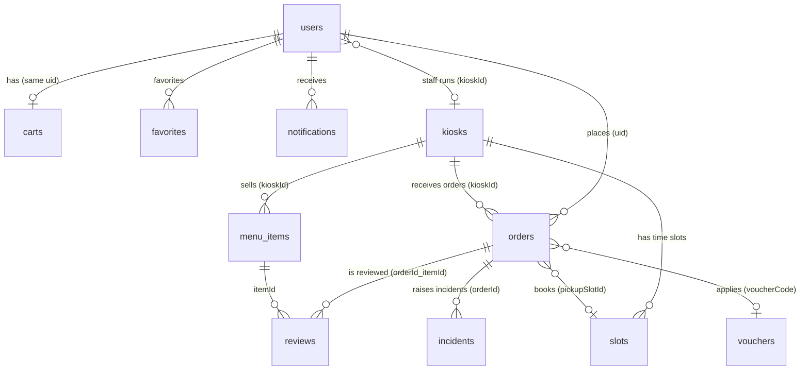
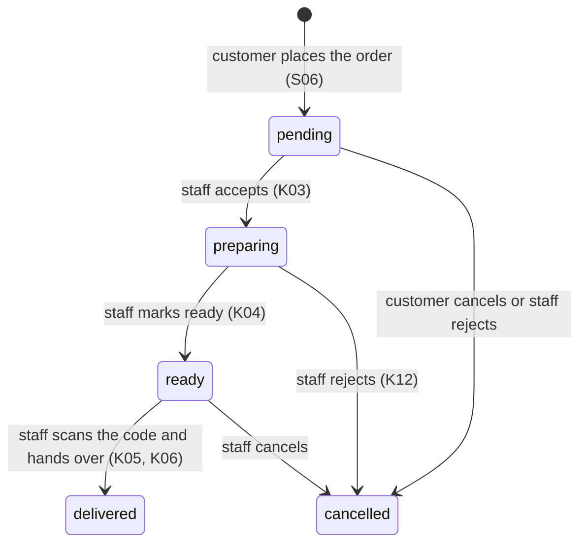

# Firestore and file storage data model

The source of truth for the data of the customer app (S01–S30) and the seller app (K01–K15). Any change to the data structure must update **all four places in the same PR**: this document, `lib/domain/models/`, `firebase/firestore.rules` (and `storage.rules`), `firebase/tests/rules.test.mjs`. Document owner: P3.

Firebase project: `breakbite-1315b`, Firestore `(default)`, region `asia-southeast1`.

## 1. Design principles

| Principle | How it applies |
|---|---|
| **Design for queries**, not for tables | Every screen has its query in section 5; any field used to filter or sort has an index |
| **Snapshots inside the order** | An order stores the item name, price, kiosk name and customer name as of the time of ordering. A later price change or kiosk rename does **not** corrupt old orders |
| **Embed when small and always read together** | `items[]` lives inside `carts/{uid}` and `orders/{id}` (at most 30 lines, tiny compared with the 1 MiB document limit) |
| **Split into a subcollection when the set keeps growing** | `favorites`, `notifications`, `slots` |
| **One kiosk, one menu** | Each `menu_items` document belongs to exactly one `kioskId`; selling at 3 kiosks means 3 documents (generated by the seed script). Sold-out is a per-counter matter |
| **Money is an integer in VND** | `priceVnd`, `totalVnd`… are `int`, never floating point |
| **Time is a server-set `Timestamp`** | On create use `FieldValue.serverTimestamp()`; the rules check `createdAt == request.time`, so a customer cannot fake the time |
| **No hard deletes** | Orders, items, kiosks, reviews and incidents cannot be deleted (`delete: false`). Items use `soldOut`, orders use `status: cancelled` |
| **Permissions by role and by kiosk** | `user`, `staff`, `admin`; staff only act on their own kiosk (`users/{uid}.kioskId`) |

## 2. Relationship diagram

Full paths: `users/{uid}`, `users/{uid}/favorites/{itemId}`, `users/{uid}/notifications/{id}`, `kiosks/{kioskId}`, `kiosks/{kioskId}/slots/{slotId}`, `menu_items/{id}`, `vouchers/{code}`, `carts/{uid}`, `orders/{id}`, `reviews/{orderId}_{itemId}`, `incidents/{id}`.

## 3. Collection details

Types: `string`, `int`, `bool`, `ts` (Timestamp), `list`, `map`. The **Written by** column says who may create or change a field (the rules block everyone else). `?` marks a field that may be absent.

### 3.1 `users/{uid}`

The id is the Firebase Auth uid. Created on the first Google sign-in (T30).

| Field | Type | Written by | Notes |
|---|---|---|---|
| `displayName` | string | owner | Taken from the Google account, editable in S16 |
| `email` | string | owner | Only the owner and admins can read the profile |
| `photoUrl` | string? | owner | |
| `role` | string | on create: `user`; on change: admin | `user`, `staff`, `admin`. Customers **cannot** change their own |
| `kioskId` | string? | admin | Only staff have it; a newly created staff member with no kiosk cannot handle anything yet |
| `studentId` | string? | owner | Student ID (S16) |
| `defaultPaymentMethod` | string? | owner | `momo`, `vnpay`, `card`, `cash` (S17) |
| `notificationPrefs` | map? | owner | `{orderStatus: bool, promo: bool}` (S18) |
| `fcmTokens` | list<string>? | owner | FCM tokens of the devices |
| `createdAt`, `lastLoginAt` | ts | owner | |

Subcollections (only the owner can read and write):
- `favorites/{itemId}`: `itemId`, `kioskId`, `name`, `priceVnd`, `imageUrl?`, `addedAt` (a snapshot so the list can render without reading each item).
- `notifications/{id}`: `title`, `body`, `orderId?`, `read`, `createdAt`. The customer app writes these itself when it sees an order status change (no server needed); FCM push messages are sent separately from the console.

### 3.2 `kiosks/{kioskId}`

Proposed ids: `q9-t2` (Campus Q9, floor 2), `q9-t4` (Campus Q9, floor 4), `nvh-t1` (Student Cultural House, floor 1).

| Field | Type | Written by | Notes |
|---|---|---|---|
| `name` | string | admin creates; staff edits | "Kiosk Q9 · Tầng 2" |
| `location` | string | staff | "Campus Q9, tầng 2" |
| `open` | bool | staff | When the counter is closed, customers **cannot order** (checked by the rules) |
| `waitMinutes` | int | staff | Estimated wait (S02, S27) |
| `openTime`, `closeTime` | string? | staff | "06:30", "17:00" |
| `notice` | string? | staff | Shown on Home when closed (S21) |
| `updatedAt` | ts | staff | |

`kiosks/{kioskId}/slots/{slotId}`: pickup time slots (S25). The id looks like `20261029-0950`.

| Field | Type | Written by | Notes |
|---|---|---|---|
| `startAt`, `endAt` | ts | staff | Each slot matches the 15-minute break between two class periods |
| `capacity` | int | staff | Maximum number of orders |
| `booked` | int | staff, and **customers ±1** | A customer booking: `+1`, cancelling: `−1`, within `[0, capacity]` (checked by the rules). Placing the order and increasing `booked` happen in one **batch** so they never drift apart |

Slots are created per day by staff or by the seed script. With no slot, the order is picked up "as soon as it is ready" (`pickupSlotId` absent).

### 3.3 `menu_items/{id}`

| Field | Type | Written by | Notes |
|---|---|---|---|
| `kioskId` | string | staff | Cannot be changed after creation |
| `name` | string | staff | Not empty |
| `searchName` | string | staff | Name without diacritics, lowercase, for search (S28). Example: "combo tacos bo pho mai" |
| `description` | string | staff | |
| `priceVnd` | int | staff | > 0 |
| `category` | string | staff | "Tacos", "Mì trộn", "Đồ uống" |
| `prepMinutes` | int | staff | ≥ 0; the "quick under 5 minutes" section filters `prepMinutes <= 5` |
| `soldOut` | bool | staff | Sold out (K09); used instead of deleting |
| `imageUrl` | string? | staff | A path to an image bundled in the app (`assets/images/menu/…`, used for the sample data) or an `https://` link to an image on Cloudinary `breakbite/menu/{kioskId}/…`. The `MenuItemImage` widget handles both; when missing or broken it shows the logo |
| `createdAt`, `updatedAt` | ts | staff | |

The average star rating is computed on the client from `reviews` (it is not stored as an aggregate because customers are not allowed to edit items).

### 3.4 `vouchers/{code}`

The id is the upper-case code (`BBSTUDENT`). Only admins create and edit.

| Field | Type | Notes |
|---|---|---|
| `title` | string | "Giảm 10K cho sinh viên" |
| `discountVnd` | int | Fixed discount |
| `percent` | int? | If present, a percentage discount capped by `maxDiscountVnd` |
| `maxDiscountVnd` | int? | |
| `minOrderVnd` | int | Minimum order |
| `expiresAt` | ts | When expired, S05-VOUCHER-ERR shows an error |
| `active` | bool | Switch a code off without deleting it |

The discount calculation: `Voucher.discountFor()` in `lib/domain/models/voucher.dart` (with tests).

### 3.5 `carts/{uid}`

One cart per person, id = uid. A cart is tied to **one kiosk**: switching kiosk asks to clear the cart.

| Field | Type | Notes |
|---|---|---|
| `kioskId` | string | |
| `items` | list<map> | At most 30 lines. Each line: `itemId`, `name`, `priceVnd`, `quantity`, `note` |
| `voucherCode` | string? | The voucher currently applied |
| `updatedAt` | ts | |

### 3.6 `orders/{id}`

An auto-generated id. This is the central collection.

| Field | Type | Written by | Notes |
|---|---|---|---|
| `orderCode` | string | customer on create | The first 6 characters of the id, upper-case; shown to the customer and staff |
| `uid` | string | customer on create | Cannot be changed |
| `customerName` | string | customer on create | Snapshot, so the counter does not need to read `users` |
| `kioskId`, `kioskName` | string | customer on create | `kioskId` cannot be changed; the counter must be open |
| `items` | list<map> | customer (while pending) | Snapshot: `itemId`, `name`, `priceVnd`, `quantity`, `note` |
| `subtotalVnd` | int | customer | Total of the items |
| `discountVnd` | int | customer | 0 ≤ discount ≤ subtotal |
| `totalVnd` | int | customer | **Must equal** `subtotalVnd − discountVnd` (checked by the rules) |
| `voucherCode` | string? | customer | |
| `paymentMethod` | string | customer on create | `momo`, `vnpay`, `card`, `cash`. **Cannot change** after ordering |
| `paymentStatus` | string | customer on create; staff only `unpaid → paid` | Simulated gateways: `paid`. Cash: `unpaid` until collected |
| `status` | string | see section 4 | `pending`, `preparing`, `ready`, `delivered`, `cancelled` |
| `pickupSlotId` | string? | customer | The slot booked |
| `pickupAt` | ts? | customer | Start time of the slot |
| `pickupCode` | string | customer on create | 6 random digits. **QR code** = `bb:<id>:<pickupCode>`; cannot be changed |
| `note` | string? | customer | A note for the whole order |
| `cancelReason`, `cancelledBy` | string? | customer or staff | `cancelledBy`: `customer` or `staff`; a staff rejection **requires a reason** |
| `createdAt` | ts | server | |
| `acceptedAt`, `readyAt`, `deliveredAt`, `cancelledAt` | ts? | staff / customer | Time of each step (K11 computes handling time) |
| `updatedAt` | ts | whoever edits | |

## 4. Order lifecycle

| Who | May do | Condition (checked by the rules) |
|---|---|---|
| Customer | Create a `pending` order | Counter `open`, total matches, cash means `unpaid`, `createdAt` is the server time |
| Customer | Edit items, pickup time, note (S09) or cancel (S07-DIALOG) | Only while `pending`; cancelling sets `cancelledBy = customer` |
| Staff | Move to exactly the next step | No skipping, no going back, only their own kiosk |
| Staff | Deliver a cash order | Must set `paymentStatus = paid` at the same time (K06-CASH) |
| Staff | Reject | `cancelledBy = staff` and a `cancelReason` |
| Admin | Same as staff, every kiosk | |
| Nobody | Delete an order | |

### Placing an order with one batch

When the customer confirms (S06), the app writes **in one `WriteBatch`**: create `orders/{id}` + delete `carts/{uid}` + (if a slot is booked) `slots/{slotId}.booked + 1`. If the batch fails nothing is written, so there is never an order with the cart still present or the other way round. Cancelling an order with a booked slot: a batch that updates the order and `booked − 1`.

## 5. Queries per screen and indexes

Every composite index is in `firebase/firestore.indexes.json` (already deployed to the project). Firestore creates single-field indexes automatically.

| Screen | Query | Index |
|---|---|---|
| S27 Kiosk picker | `kiosks` | automatic |
| S02, S03 Menu | `menu_items` where `kioskId == k` orderBy `name` | (kioskId, name) |
| S03 filter by category | `menu_items` where `kioskId == k` and `category == c` orderBy `name` | (kioskId, category, name) |
| S02 "quick under 5 minutes" | `menu_items` where `kioskId == k` and `prepMinutes <= 5` orderBy `prepMinutes` limit `quick_items_limit` | (kioskId, prepMinutes) |
| S28 Search | `menu_items` where `kioskId == k` and `searchName >= q` and `searchName < q + ''` | (kioskId, searchName) |
| S04 Detail, S22 Alternatives | `menu_items/{id}`; alternatives: same `kioskId` and `category`, `soldOut == false` | automatic |
| S05 Cart | `carts/{uid}` (listen) | — |
| S29 Voucher picker | `vouchers` where `active == true` | automatic |
| S25 Pickup time | `kiosks/{k}/slots` where `startAt >= now` orderBy `startAt` | automatic |
| S07 Tracking | `orders/{id}` (listen) | — |
| S08, S11, S14 History, reorder | `orders` where `uid == me` orderBy `createdAt desc`, *paged* | (uid, createdAt desc) |
| S13 Favorites | `users/{uid}/favorites` orderBy `addedAt desc` | automatic |
| S19 Notifications | `users/{uid}/notifications` orderBy `createdAt desc`, *paged* | automatic |
| S23 Review | `reviews/{orderId}_{itemId}`; item reviews: `reviews` where `itemId == m` orderBy `createdAt desc` | (itemId, createdAt desc) |
| S24 Incident report | create `incidents`; the customer reads: where `uid == me` orderBy `createdAt desc` | (uid, createdAt desc) |
| K02 Order queue | `orders` where `kioskId == mine` and `status in [pending, preparing, ready]` orderBy `createdAt desc` | (kioskId, status, createdAt desc) |
| K05 Scan code | `orders` where `kioskId == mine` and `pickupCode == c` and `status == 'ready'` | (kioskId, pickupCode, status) |
| K08 Menu management | like S03, without filtering `soldOut` | (kioskId, name) |
| K11 Shift statistics | `orders` where `kioskId == mine` and `createdAt >= startOfShift`, using `count()` and `sum(totalVnd)` | (kioskId, createdAt desc) |
| K13 Customer incidents | `incidents` where `kioskId == mine` and `status == s` orderBy `createdAt desc`, *paged* | (kioskId, status, createdAt desc) |

**Long lists are paged** with a cursor (`Paged<T>`, 20 per page, at most 50): the queries marked *paged* above add `limit` and `startAfterDocument`; see `CONTRIBUTING.md` section 7.

**A note on rules and queries.** Rules are not filters: a staff query **must include** `where('kioskId', isEqualTo: myKiosk)` and a customer query must include `where('uid', isEqualTo: me)`, otherwise Firestore rejects the whole query.

## 6. File storage (Cloudinary)

Cloud Storage for Firebase now requires the Blaze plan, which needs a payment card. The team stays on Spark and stores files on **Cloudinary** (free plan) instead, through `CloudinaryStorageService` (`lib/data/services/cloudinary/`), which implements the same `StorageService` interface. The lecturer's approval of this substitution is requested in T11, as the handout's tool note requires.

| Folder on Cloudinary | Content | Uploaded by | Opened by |
|---|---|---|---|
| `breakbite/reports/{uid}/…` | PDF receipt exported by the customer (T43) | that customer | that customer (link shown in the app) |
| `breakbite/incidents/{uid}/…` | Incident evidence photo (S24) | that customer | the customer, staff of the order's kiosk |
| `breakbite/menu/{kioskId}/…` | Item photo (K14, K15) | staff of that kiosk | everyone |

How access is controlled without a server:

| Layer | What it enforces |
|---|---|
| App (`StorageService`) | Only signed-in users reach an upload button; files over 5 MB are refused before upload; progress and the final URL are shown |
| Cloudinary unsigned upload preset | Allowed formats only (`pdf`, `jpg`, `png`, `webp`), unique random file names, no overwrite |
| Firestore | The URL and `publicId` are saved in Firestore (`orders`, `incidents.photoUrl`, `menu_items.imageUrl`, and a `reports` metadata collection planned with the next data-model change), so **which files a user can list** is decided by `firestore.rules` (owner only) |

Limitations, to state in the report's risks section:

| Limitation | Consequence | Mitigation |
|---|---|---|
| The upload preset is unsigned, so it is visible inside the APK | Anyone who extracts it can upload files to the account | Formats and sizes are restricted by the preset; signed uploads would need a server (Cloud Functions, not on Spark) |
| Files are public by URL | Anyone holding a link can open the file | File names are long and random, links are only stored in owner-readable Firestore documents, receipts contain no personal data beyond the order |
| New Cloudinary accounts block PDF delivery | The PDF link returns an error | Enable *Settings → Security → Allow delivery of PDF and ZIP files* (see `docs/setup.md`) |

`firebase/storage.rules` is kept, unused, as the fallback if the lecturer does not approve Cloudinary.

## 7. What the rules can and cannot do

The rules (verified by 82 tests on the Emulator) block: reading other people's data, raising your own privileges, skipping status steps, editing another kiosk's orders, ordering from a closed counter, orders with a wrong total, reviewing before receiving the order, reviewing twice.

Limitations because there is **no dedicated server** (Spark, no Cloud Functions). They must be written up in the risks section of the report:

| Limitation | Consequence | Mitigation |
|---|---|---|
| The rules cannot loop over `items[]`, so they **cannot check that the item amounts match the prices in `menu_items`** | A customer with a hacked app could write a lower price | The rules still force `total = subtotal − discount`; staff see each line's price at handover. In production, Cloud Functions would recompute it |
| Payment is **simulated** (D02) | `paymentStatus = paid` is written by the app | Say so clearly in the documents; for cash, staff confirm |
| Customers adjust `slots.booked` themselves | A fake reservation is possible | Only ±1 per change and within capacity |
| In-app notifications are **written by the client** | No message when the app is closed | Push messages while the app is in the background are sent from the FCM console (matches the Lab 3 test requirement) |
| Search only **matches the beginning of the string** (`searchName`) | You cannot find a word in the middle | Small menu: filtering on the client after loading the kiosk's items is acceptable |

## 8. Sample data (T31)

The script in `firebase/seed/` (how to run it: `firebase/README.md`) loads:
- 3 kiosks (`q9-t2`, `q9-t4` open; `nvh-t1` closed to try S21) and pickup slots, 4 per working day for the next 7 days, for the open kiosks (the slots at 08:45, 10:15, 13:15, 14:45; edit them in `data.mjs`).
- 25 items: 10 per open kiosk (including an item with `soldOut: true` to try S22 and items with `prepMinutes <= 5` for the "quick" section) and 5 for the closed kiosk. Each item has an illustration photo in `assets/images/menu/` (source Unsplash, authors in `CREDITS.md`).
- 3 vouchers: `BBSTUDENT` (valid), `GIOVANG` (Golden Hour Combo, 15% off up to 15K, matching the Home banner), `BB20` (expired, to try S05-VOUCHER-ERR).
- Staff and admin accounts **cannot be loaded by the data script** because they need the Firebase Auth uid: that person signs in with Google once, then you run `set-role.mjs` to assign the role (for staff also a `kioskId`).

By default the script does not overwrite existing documents, so re-running it does not lose the `soldOut` or `booked` values that staff and customers have changed.

## 9. Process for changing the structure

1. Edit the relevant section of this document.
2. Edit the model file in `lib/domain/models/` (add **optional** fields or fields with a default value, so other people's code still compiles).
3. Edit `firebase/firestore.rules`; add allowed and denied tests to `rules.test.mjs`; run `npm test` in `firebase/tests`.
4. If there is a new query: add the index to `firestore.indexes.json`.
5. Open a PR and have the document owner (P3) review it. Deploy with `firebase deploy --only firestore:rules,firestore:indexes`.
