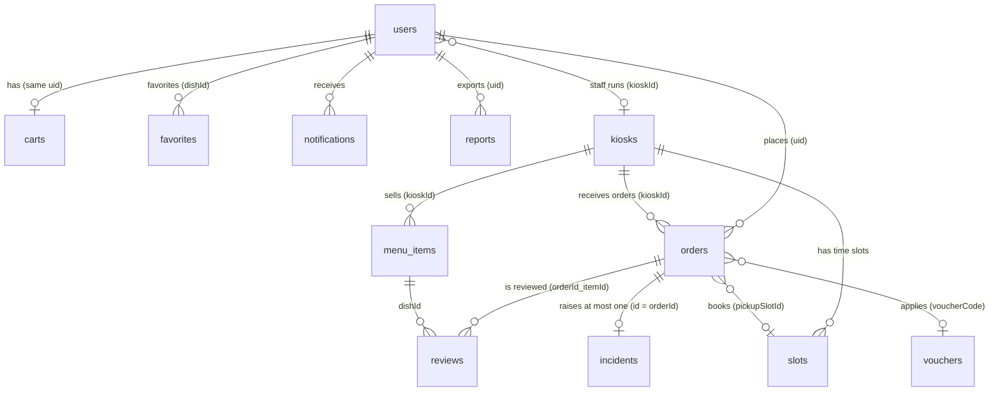
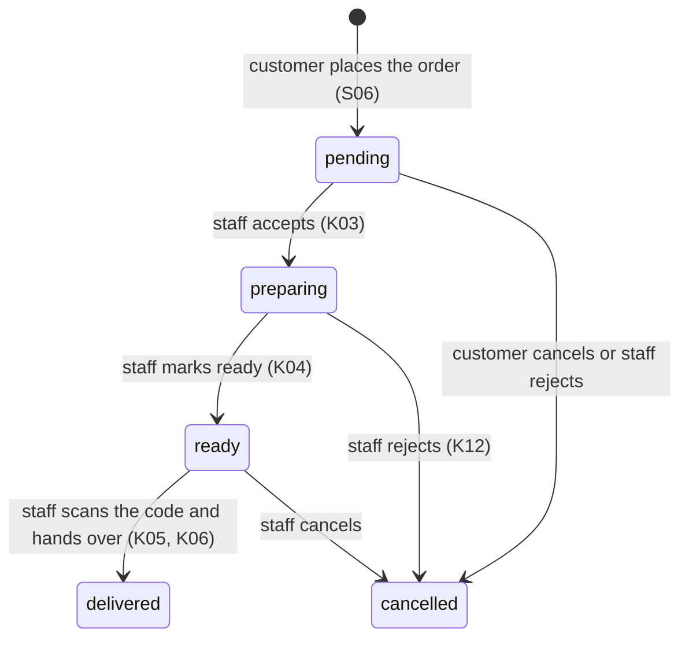

# Firestore and file storage data model

The source of truth for the data of the customer app (S01–S30) and the seller app (K01–K15). Any change to the data structure must update **all four places in the same PR**: this document, `lib/domain/models/`, `firebase/firestore.rules`, `firebase/tests/rules.test.mjs` (and the seed and indexes when they are affected), plus a migration in `firebase/seed/migrations/` when data already stored has to change (`CONTRIBUTING.md` section 3.1). Document owner: P3.

Firebase project: `breakbite-1315b`, Firestore `(default)`, region `asia-southeast1`.

## 1. Design principles

| Principle | How it applies |
|---|---|
| **Design for queries**, not for tables | Every screen has its query in section 5; any field used to filter or sort has an index |
| **Snapshots inside the order** | An order stores the item name, price, kiosk name and customer name as of the time of ordering. A later price change or kiosk rename does **not** corrupt old orders |
| **Embed when small and always read together** | `items[]` lives inside `carts/{uid}` and `orders/{id}` (at most 30 lines, tiny compared with the 1 MiB document limit); a voucher's `discount` is a map |
| **Split into a subcollection when the set keeps growing** | `favorites`, `notifications`, `slots` |
| **One kiosk, one menu; one dish, many kiosks** | Each `menu_items` document belongs to exactly one kiosk, id `{kioskId}-{dishId}`. The same dish at several kiosks shares `dishId`, so favorites and reviews follow the dish, not the counter. Sold-out is a per-counter matter |
| **Natural keys where the rules need them** | A voucher's id is its upper-case code and an incident's id is its order id: the rules can `get()` by path (they cannot query by field), codes cannot repeat and an order cannot get two incidents |
| **Money is an integer in VND** | `priceVnd`, `totalVnd`… are `int`, never floating point |
| **Every document has `createdAt` and `updatedAt`, set by the server** | Write `FieldValue.serverTimestamp()` (helper `Stamp` in `lib/data/firebase/firestore_helpers.dart`); the rules require `createdAt == updatedAt == request.time` on create, `updatedAt == request.time` on every update and never let `createdAt` change |
| **Enum values are the Dart enum names** | Stored exactly as `.name` (`missingItem`, `inProgress`, `food`), read with `readEnum`; no snake_case mapping table |
| **No hard deletes** | Orders, items, kiosks, vouchers, reviews, incidents and reports cannot be deleted. Items use `soldOut`, vouchers `active`, orders `status: cancelled` |
| **Permissions by role and by kiosk** | `user`, `staff`, `admin`; staff only act on their own kiosk (`users/{uid}.kioskId`) and only on its operating fields |

## 2. Relationship diagram

Full paths: `users/{uid}`, `users/{uid}/favorites/{dishId}`, `users/{uid}/notifications/{id}`, `kiosks/{kioskId}`, `kiosks/{kioskId}/slots/{slotId}`, `menu_items/{kioskId}-{dishId}`, `vouchers/{CODE}`, `carts/{uid}`, `orders/{id}`, `reviews/{orderId}_{itemId}`, `incidents/{orderId}`, `reports/{id}`; for the final assignment `announcements/{id}`.

## 3. Collection details

Types: `string`, `int`, `bool`, `ts` (Timestamp), `list`, `map`. The **Written by** column says who may create or change a field (the rules block everyone else). `?` marks a field that may be absent. `createdAt` and `updatedAt` (section 1) are on every document and not repeated below.

### 3.1 `users/{uid}`

The id is the Firebase Auth uid. Created on the first Google sign-in (T30). Only the owner and admins can read it.

| Field | Type | Written by | Notes |
|---|---|---|---|
| `displayName` | string | owner | Taken from the Google account, editable in S16 (1–60 characters when changed) |
| `email` | string | on create only | From Google; the owner **cannot** change it |
| `photoUrl` | string? | owner | |
| `role` | string | on create: `user`; then admin only | `user`, `staff`, `admin` |
| `kioskId` | string? | admin | Only staff have it; a staff member with no kiosk cannot handle anything |
| `studentId` | string? | owner | Student ID (S16): 2 capital letters and 6 digits, for example `SE183398` |
| `defaultPaymentMethod` | string? | owner | `momo`, `vnpay`, `card`, `cash` (S17) |
| `notificationPrefs` | map? | owner | `{orderReady, breakReminder, promo, orderUpdates}`, all bool (S18, D33). A missing key means its default (all on except `promo`); new optional keys, no migration |
| `fcmTokens` | list<string>? | owner | At most 5. Add this device's token after sign-in, remove it on sign-out |
| `phone` | string? | owner | 10 digits starting with 0 (S16) |
| `defaultKioskId` | string? | owner | Must be an existing kiosk (S16); the app selects it at every sign-in |
| `lastLoginAt` | ts? | owner | |

Subcollections (only the owner can read and write):
- `favorites/{dishId}`: `dishId`, `name`, `category?`, `priceVnd`, `imageUrl?`. Kept per **dish**, so switching kiosk keeps the favorite; whether it is on sale and its price come from `menu_items` of the selected kiosk. "Ordered N times" (S13) is counted from orders, not stored.
- `notifications/{id}`: `title`, `body`, `orderId?`, `read`. The customer app writes these itself when it sees an order status change (no server); **the id is `AppNotification.idForOrder(orderId, status)`** (`{orderId}_{status}`) written with `set`, so the same change seen on two devices, or twice, stays one notification. FCM push messages are sent separately from the console.

### 3.2 `kiosks/{kioskId}`

Ids: `q9-t2` (Campus Q9, floor 2), `q9-t4` (Campus Q9, floor 4), `nvh-t1` (Student Cultural House, floor 1).

| Field | Type | Written by | Notes |
|---|---|---|---|
| `name`, `location` | string | admin | "Kiosk Q9 · Tầng 2", "Campus Q9, tầng 2" |
| `open` | bool | staff | K10 "Đang nhận đơn". When false, customers **cannot order** (rules) |
| `pausedUntil` | ts? | staff | K10 "pause 15 minutes": no orders until then (rules) |
| `waitMinutes` | int | staff | 0–120; estimated wait (S02, S27) |
| `maxOrdersPerSlot` | int? | staff | > 0; default capacity of new slots |
| `openTime`, `closeTime` | string? | staff | "06:30", "17:00" on the phone's clock. Orders are refused outside them (the app checks, as for a pause; the rules only check `open`); closing before opening means past midnight; without both times there are no hours to keep |
| `notice` | string? | staff | Shown on Home when closed (S21) |

Staff can change only `open`, `pausedUntil`, `waitMinutes`, `maxOrdersPerSlot`, `notice`, `openTime`, `closeTime`; the rules check their types.

`kiosks/{kioskId}/slots/{slotId}`: pickup time slots (S25). The id looks like `20261029-0950`.

| Field | Type | Written by | Notes |
|---|---|---|---|
| `startAt`, `endAt` | ts | staff | Each slot matches the 15-minute break between two class periods |
| `capacity` | int | staff | Maximum number of orders |
| `booked` | int | staff, and **customers ±1** | Booking `+1`, cancelling `−1`, within `[0, capacity]` (rules). **Always write `FieldValue.increment(±1)`**, never a number you read: with a number, two customers booking at the same moment both write the same value and one booking is lost. Placing the order and the `+1` happen in one batch |

Slots are created per day by staff or by the seed script, which creates the next 7 working days only: **run the seed again on the morning of the demo**. With no slot, the order is picked up "as soon as it is ready" (`pickupSlotId` absent).

### 3.3 `menu_items/{kioskId}-{dishId}`

| Field | Type | Written by | Notes |
|---|---|---|---|
| `kioskId` | string | staff | Cannot change after creation |
| `dishId` | string | staff | Slug shared by the same dish at every kiosk (`tacos-bo`); cannot change; the document id must be `{kioskId}-{dishId}` |
| `name` | string | staff | Not empty |
| `searchName` | string | staff | `name` without diacritics, lowercase (S28), e.g. "combo tacos bo pho mai". The repository recomputes it on every write of `name` |
| `description` | string | staff | |
| `priceVnd` | int | staff | > 0; price before options |
| `category` | string | staff | `food`, `drink`, `other` (Figma K14, S13, S28) |
| `prepMinutes` | int | staff | ≥ 0; the "quick" section filters `prepMinutes <= 5` |
| `soldOut` | bool | staff | Sold out (K09); used instead of deleting |
| `soldOutReason` | string? | staff | `outOfIngredients`, `machineBroken`, `other` (K09) |
| `availableAgainAt` | ts? | staff | "Có lại lúc 10:30" (K09, S22). Display only: the item stays sold out until staff switch `soldOut` off |
| `optionGroups` | list<map>? | staff | At most 5 groups (spice level, toppings — S04). **Not used in Lab 3 (DB-02/04):** the customer writes preferences in the line `note`; the rules still accept the field so the final assignment can add options without a migration |
| `imageUrl` | string? | staff | A bundled asset (`assets/images/menu/…`, sample data) or an `https://` Cloudinary link `breakbite/menu/{kioskId}/…`, which K14/K15 upload when the item is saved. `MenuItemImage` handles both and falls back to the logo. Removing the photo deletes the field (`FieldValue.delete()`), it is not set to null |
| `archived` | bool? | staff, admin (web admin W02) | Final assignment. `true` hides the item from the customer menu, search and the seller menu (`MenuRepository.watchMenu` leaves it out unless `includeArchived`) and a cart holding it sees it as no longer sold; the web admin can restore it. Absent means `false`, so **no migration** |

The average rating (S04) is an aggregation query, `average('rating')` over `reviews` where `dishId == d`; it is not stored because customers cannot edit items.

### 3.4 `vouchers/{CODE}`

The id is the upper-case code (`BBSTUDENT`, 3–20 letters or digits). Only admins create and edit; nobody deletes (switch `active` off).

| Field | Type | Notes |
|---|---|---|
| `title` | string | "Giảm 10K cho sinh viên" |
| `discount` | map | **Exactly one** shape: `{type: 'fixed', amountVnd}` (> 0) or `{type: 'percent', percent, maxVnd}` (1–100 %, cap > 0 required). The rules reject a map mixing both, a percentage without a cap or over 100 % |
| `minOrderVnd` | int | Minimum subtotal, ≥ 0 |
| `startsAt` | ts? | Absent = valid now |
| `expiresAt` | ts | When past, S05-VOUCHER-ERR shows an error |
| `activeFrom`, `activeTo` | string? | Daily window `"HH:mm"` in Vietnam time, both or neither (GIOVANG: 10:15–10:30). Checked by the app |
| `active` | bool | Switch a code off without deleting it |

The discount: `Voucher.discountFor()` in `lib/domain/models/voucher.dart` — fixed: `min(amountVnd, subtotal)`; percent: `min(floor(subtotal × percent / 100), maxVnd)`. The rules apply **the same formula** when an order is created or edited (section 4).

### 3.5 `carts/{uid}`

One cart per person, id = uid. A cart is a draft tied to **one kiosk**: switching kiosk asks to clear it.

| Field | Type | Notes |
|---|---|---|
| `kioskId` | string | Required |
| `items` | list<map> | At most 30 lines: `itemId`, `name`, `priceVnd`, `quantity`, `note` |
| `voucherCode` | string? | The voucher currently applied |
| `pickupSlotId`, `pickupAt` | string?, ts? | The time chosen in S25, kept through S05 → S06 and app restarts |

`CartRepository` (DB-23): `watchCart(uid)` emits a `Cart` (empty when the document does not exist); `addItem(uid, kioskId:, item:)` merges the same item and refuses an item of another kiosk while the cart has lines; `setQuantity` (0 removes the line), `setNote`, `replaceItems` (after repricing), `setVoucher`, `setPickup(slot)` and `clear`. Every change is a transaction; a cart whose last line is removed is deleted.

Prices in a cart are a snapshot from when the item was added. **Right before placing the order (S06), re-read the items and call `repriceCart()`** (`lib/domain/cart_repricing.dart`): if a price changed, an item sold out or is no longer sold, show the changes, save the new lines and let the customer confirm again.

### 3.6 `orders/{id}`

An auto-generated id. The central collection.

| Field | Type | Written by | Notes |
|---|---|---|---|
| `orderCode` | string | customer on create | First 6 characters of the id, upper-case |
| `uid` | string | customer on create | Cannot change |
| `customerName` | string | customer on create | Snapshot, so the counter does not read `users` |
| `kioskId`, `kioskName` | string | customer on create | `kioskId` cannot change; the kiosk must accept orders (`open` and not paused) |
| `items` | list<map> | customer (while pending) | Snapshot: `itemId`, `name`, `priceVnd`, `quantity`, `note` |
| `subtotalVnd` | int | customer | Total of the items |
| `discountVnd` | int | customer | **No voucher → 0. With a voucher → exactly what the voucher gives** (rules, section 4) |
| `totalVnd` | int | customer | **Must equal** `subtotalVnd − discountVnd` |
| `voucherCode` | string? | customer | Document id in `vouchers` |
| `paymentMethod` | string | customer on create | `momo`, `vnpay`, `card`, `cash`; never changes |
| `paymentStatus` | string | customer on create; staff only `unpaid → paid` | Simulated gateways: `paid`. Cash: `unpaid` until collected |
| `status` | string | see section 4 | `pending`, `preparing`, `ready`, `delivered`, `cancelled` |
| `pickupSlotId`, `pickupAt` | string?, ts? | customer | The slot booked and its start |
| `pickupCode` | string | customer on create | 6 random digits; **QR** = `bb:<id>:<pickupCode>`; never changes. Two ready orders of a kiosk may share a code (1 in a million): K05 then lists both |
| `note` | string? | customer | A note for the whole order |
| `cancelReason`, `cancelledBy` | string? | customer or staff | A staff rejection **requires a reason** and `cancelledBy = staff` |
| `acceptedAt`, `readyAt`, `deliveredAt`, `cancelledAt` | ts? | staff / customer | **Must be the server time of that step** (rules), so K11 can trust them |
| `readyBy` | ts? | staff, when accepting | Promised ready time, in the future (S07 estimate, K04 countdown) |
| `prepSeconds` | int? | staff, when ready | `readyAt − acceptedAt` in seconds; K11 averages it with an aggregation query |

### 3.7 `reviews/{orderId}_{itemId}`

One review per item per order, only after that order was delivered. Every signed-in user can read reviews.

| Field | Type | Notes |
|---|---|---|
| `orderId`, `itemId`, `dishId`, `kioskId` | string | `dishId` gathers reviews of a dish across kiosks |
| `uid` | string | The author; must be the order's customer |
| `authorName` | string? | **Public**, so only `Review.publicAuthorName()` ("Quân N."), at most 30 characters |
| `rating` | int | 1–5 |
| `comment` | string? | At most 500 characters |
| `tags` | list<string>? | At most 4: `tasty`, `fast`, `hot`, `wellPacked` (S23) |

The owner may later change `rating`, `comment` and `tags`.

### 3.8 `incidents/{orderId}`

The id is the order id: **at most one incident per order**, so K13 cannot be flooded.

| Field | Type | Written by | Notes |
|---|---|---|---|
| `orderId`, `kioskId`, `uid` | string | customer on create | Must be the customer's own order at that kiosk |
| `customerName` | string? | customer on create | |
| `type` | string | customer on create | `missingItem`, `wrongItem`, `quality`, `late`, `other` |
| `description` | string | customer on create | At most 500 characters; nobody edits it afterwards |
| `photoUrl` | string? | customer on create | Cloudinary `breakbite/incidents/{uid}/…` |
| `status` | string | customer creates `open`; staff then | `open`, `inProgress`, `resolved` |
| `resolution` | string? | staff | `refunded` or `rejected` |
| `refundVnd` | int? | staff | With `refunded`: > 0 and ≤ the order total (simulated; the order's `paymentStatus` is not changed) |
| `resolutionNote` | string? | staff | Required with `rejected` |
| `resolvedAt`, `handledBy` | ts?, string? | staff | Server time; the staff member's own uid |

### 3.9 `reports/{id}`

Metadata of a generated PDF (the orders summary from the Firebase demo area, the receipt of T43); the file itself is on Cloudinary. Only the owner creates and reads; nobody edits or deletes.

| Field | Type | Notes |
|---|---|---|
| `uid` | string | The owner |
| `orderId` | string? | Must be the owner's order |
| `fileName`, `publicId` | string | |
| `url` | string | `https://` link returned by Cloudinary |
| `sizeKb` | int | 1–5120 |

### 3.10 `announcements/{id}` (final assignment)

Written by admins from the web admin; customers read only `published` ones in the inbox (S19), where the read state is a notification with id `AppNotification.idForAnnouncement(id)`. Fields: `title`, `body`, `kioskId?` (absent = every kiosk), `status` (`draft`, `published`, `archived`), `createdBy`, `publishedAt?`.

Rules (`validAnnouncement`): only admins create and update; the keys are exactly these fields plus the timestamps, `title` 1–120 characters, `body` 1–1000, `status` one of the three values, `createdBy` is the author on create and never changes, nobody deletes. Status transitions: `draft → published`, `published → archived` (web W05). Screens: web W05 (all, admins), mobile S19 (published, `kioskId` absent or the customer's kiosk; index `status ASC, publishedAt DESC`). Model `Announcement`, repository `AnnouncementRepository` in `packages/core`.

### 3.11 `audit_logs/{id}` (system administration pages of the web admin)

One line per change made on the system administration pages, written in the **same batch or transaction** as the change, so a change never exists without its line. Only admins read; nobody edits or deletes. Fields: `actorUid` (must be the signed-in admin), `actorName`, `action` (`user.access`, `kiosk.save`, `slots.create`, `voucher.save`), `target` (a path such as `users/<uid>`), `summary` (a sentence), `createdAt`, `updatedAt`.

The rules for `users` let an admin change only `role` and `kioskId`: the role must be `user`, `staff` or `admin`, staff need a kiosk that exists, and an admin cannot change their own role or kiosk. The orders list of the system pages needs the index `orders (status ASC, createdAt DESC)`.

## 4. Order lifecycle

| Who | May do | Condition (checked by the rules) |
|---|---|---|
| Customer | Create a `pending` order | Kiosk `open` and not paused; total matches; discount is exactly the voucher's (or 0); cash means `unpaid`; `createdAt`, `updatedAt` are the server time |
| Customer | Edit items, pickup time, note (S09) | Only while `pending`; total and discount checked again |
| Customer | Cancel (S07-DIALOG) | Only while `pending`; `cancelledBy = customer`, `cancelledAt` = server time |
| Staff | Move to exactly the next step | No skipping, no going back, only their own kiosk; the step's time field (`acceptedAt`, `readyAt`, `deliveredAt`, `cancelledAt`) = server time; `readyBy` in the future; `prepSeconds ≥ 0` |
| Staff | Deliver a cash order | Must set `paymentStatus = paid` at the same time (K06-CASH) |
| Staff | Reject | `cancelledBy = staff` and a `cancelReason` |
| Admin | Same as staff, every kiosk | |
| Nobody | Delete an order | |

### Placing an order in one transaction

When the customer confirms (S06), after `repriceCart()` found no change, `OrderRepository.placeOrder` runs **one transaction**: it reads the kiosk (open, not paused), the voucher and the slot (exists, not full, not over), computes the discount with the same formula as the rules, then creates `orders/{id}` + deletes `carts/{uid}` + `slots/{slotId}.booked: FieldValue.increment(1)`. A problem stops the transaction before anything is written and comes back as a readable `ValidationException` ("Đơn tối thiểu 40.000đ để dùng mã BBSTUDENT.") instead of a rules rejection. Editing (S09), cancelling and every staff step also read the order inside a transaction first, so a step on an order that changed meanwhile fails with "Đơn này vừa được xử lý ở nơi khác"; cancelling or rejecting an order with a slot releases it with `increment(-1)` in the same transaction. Placing an order needs a connection (a transaction cannot be queued offline).

## 5. Queries per screen and indexes

Every composite index is in `firebase/firestore.indexes.json`. Firestore creates single-field indexes automatically.

| Screen | Query | Index |
|---|---|---|
| S27 Kiosk picker | `kiosks` | automatic |
| S02, S03 Menu | `menu_items` where `kioskId == k` orderBy `name` | (kioskId, name) |
| S03 filter by category | `menu_items` where `kioskId == k` and `category == c` orderBy `name` | (kioskId, category, name) |
| S02 "quick under 5 minutes" | `menu_items` where `kioskId == k` and `prepMinutes <= 5` orderBy `prepMinutes` limit `quick_items_limit` | (kioskId, prepMinutes) |
| S28 Search | `menu_items` where `kioskId == k` and `searchName >= q` and `searchName < q + ''` | (kioskId, searchName) |
| S04 Detail, S22 Alternatives | `menu_items/{id}`; alternatives: same `kioskId` and `category`, `soldOut == false` | automatic |
| S04 Rating | `reviews` where `dishId == d`, `average('rating')` (aggregation) | automatic |
| S05 Cart | `carts/{uid}` (listen) | — |
| S06 Checkout | `menu_items` of the cart lines (re-read before ordering) | — |
| S29 Voucher picker | `vouchers` where `active == true` | automatic |
| S25 Pickup time | `kiosks/{k}/slots` where `startAt >= now` orderBy `startAt` | automatic |
| S07 Tracking | `orders/{id}` (listen) | — |
| S08 tab "Đang xử lý" | `orders` where `uid == me` and `status in [pending, preparing, ready]` orderBy `createdAt desc` | (uid, status, createdAt desc) |
| S08 tab "Lịch sử", S11, S14 | `orders` where `uid == me` orderBy `createdAt desc`, *paged* | (uid, createdAt desc) |
| S13 Favorites | `users/{uid}/favorites` orderBy `createdAt desc`; then `menu_items` where `kioskId == k` and `dishId in [...]` (≤ 30) for price and stock | automatic; (kioskId, dishId) |
| S19 Notifications | `users/{uid}/notifications` orderBy `createdAt desc`, *paged*; unread dot: `read == false` count | automatic |
| S23 Review | `reviews/{orderId}_{itemId}`; the customer's reviews of one order: `reviews` where `uid == me` and `orderId == x`; a dish's reviews: `reviews` where `dishId == d` orderBy `createdAt desc` | (dishId, createdAt desc) for a dish; none for one order |
| S24 Incident report | `incidents/{orderId}`; the customer's report of one order: where `uid == me` and `orderId == x` (a query, because `get` of a missing document is refused by the owner rule); the customer's list: where `uid == me` orderBy `createdAt desc` | (uid, createdAt desc) for the list; none for the single order |
| Firebase demo area, T43 receipts | `reports` where `uid == me` orderBy `createdAt desc` limit 10 | (uid, createdAt desc) |
| K02 Order queue | `orders` where `kioskId == mine` and `status in [pending, preparing, ready]` orderBy `createdAt desc` | (kioskId, status, createdAt desc) |
| K05 Scan code | `orders` where `kioskId == mine` and `pickupCode == c` and `status == 'ready'` | (kioskId, pickupCode, status) |
| K08 Menu management | like S03, without filtering `soldOut` | (kioskId, name) |
| K11 Shift statistics | `orders` where `kioskId == mine` and `createdAt >= startOfShift`: `count()`, `sum('totalVnd')`, `average('prepSeconds')`; the hourly chart reads that shift's orders (a few hundred at most) | (kioskId, createdAt desc); for the aggregation with `status == 'delivered'`: (kioskId, status, createdAt, prepSeconds, totalVnd), all ascending; for the counts of cancelled and active orders: (kioskId, status, createdAt), all ascending (the existing one has `createdAt` descending, which these queries cannot use). The Emulator does not ask for it, the real Firestore does: without it the screen fails with `FAILED_PRECONDITION` |
| K13 Customer incidents | `incidents` where `kioskId == mine` and `status == s` orderBy `createdAt desc`, *paged* | (kioskId, status, createdAt desc) |

**Long lists are paged** with a cursor (`Paged<T>`, 20 per page, at most 50): the queries marked *paged* add `limit` and `startAfterDocument`; see `CONTRIBUTING.md` section 7.

**Rules are not filters.** A staff query **must include** `where('kioskId', isEqualTo: myKiosk)` and a customer query `where('uid', isEqualTo: me)`, otherwise Firestore rejects the whole query.

## 6. File storage (Cloudinary)

Cloud Storage for Firebase now requires the Blaze plan, which needs a payment card. The team stays on Spark and stores files on **Cloudinary** (free plan) instead, through `CloudinaryStorageService` (`lib/data/services/cloudinary/`), which implements the same `StorageService` interface. The lecturer's approval of this substitution is requested in T11, as the handout's tool note requires.

| Folder on Cloudinary | Content | Uploaded by | Opened by |
|---|---|---|---|
| `breakbite/reports/{uid}/…` | PDF receipt exported by the customer (T43) | that customer | that customer (link shown in the app) |
| `breakbite/incidents/{uid}/…` | Incident evidence photo (S24) | that customer | the customer, staff of the order's kiosk |
| `breakbite/menu/{kioskId}/…` | Item photo (K14, K15) | staff of that kiosk | everyone |

How access is controlled without a server:

| Layer | What it enforces |
|---|---|
| App (`StorageService`) | Only signed-in users reach an upload button; files over 5 MB are refused before upload; progress and the final URL are shown |
| Cloudinary unsigned upload preset | Allowed formats only (`pdf`, `jpg`, `png`, `webp`), unique random file names, no overwrite |
| Firestore | The URL and `publicId` are saved in Firestore (`reports`, `incidents.photoUrl`, `menu_items.imageUrl`), so **which files a user can list** is decided by `firestore.rules` (owner only) |

Limitations, to state in the report's risks section:

| Limitation | Consequence | Mitigation |
|---|---|---|
| The upload preset is unsigned, so it is visible inside the APK | Anyone who extracts it can upload files to the account | Formats and sizes are restricted by the preset; signed uploads would need a server (Cloud Functions, not on Spark) |
| Files are public by URL | Anyone holding a link can open the file | File names are long and random, links are only stored in owner-readable Firestore documents, receipts contain no personal data beyond the order |
| New Cloudinary accounts block PDF delivery | The PDF link returns an error | Enable *Settings → Security → Allow delivery of PDF and ZIP files* (see `docs/setup.md`) |

`firebase/storage.rules` is kept, unused, as the fallback if the lecturer does not approve Cloudinary.

## 7. What the rules can and cannot do

The rules (verified by `firebase/tests/rules.test.mjs` on the Emulator, every role × collection with allowed and denied cases) block: reading other people's data, raising your own privileges or changing your email, skipping status steps or faking their times, editing another kiosk's orders or a kiosk's name as staff, ordering from a closed or paused counter, orders with a wrong total or **a discount the voucher does not give**, vouchers mixing a fixed amount and a percentage, items with an unknown category or a wrong id, a second incident for one order, refunds above the order total, rejecting without an explanation, reviewing before receiving the order or twice, and any write without the server's `createdAt`/`updatedAt`.

Limitations because there is **no dedicated server** (Spark, no Cloud Functions). They must be written up in the risks section of the report:

| Limitation | Consequence | Mitigation |
|---|---|---|
| The rules cannot loop over `items[]`, so they **cannot check that line prices match `menu_items`** | A customer with a hacked app could write a lower price, also when editing a pending order (S09 lets the app change only time, quantity and note, but the rules cannot tell) | The rules force `total = subtotal − discount` and the voucher's exact discount; the app reprices the cart before ordering (`repriceCart`); staff see each line at handover. In production, Cloud Functions would recompute it |
| Payment is **simulated** (D02) | `paymentStatus = paid` is written by the app | Say so clearly in the documents; for cash, staff confirm |
| Customers adjust `slots.booked` themselves | A fake reservation or release is possible | Only ±1 per change and within capacity; `increment` keeps concurrent bookings correct |
| A voucher's daily window (`activeFrom`/`activeTo`) is checked by the app only | A hacked app could use GIOVANG outside 10:15–10:30 | Small amount, capped; the rules still check expiry, `active`, minimum and the amount |
| In-app notifications are **written by the client** | No message when the app is closed | Push messages while the app is in the background are sent from the FCM console (matches the Lab 3 test requirement) |
| Search only **matches the beginning of the string** (`searchName`) | You cannot find a word in the middle | Small menu: filtering on the client after loading the kiosk's items is acceptable |

## 8. Sample data (T31)

The script in `firebase/seed/` (how to run it: `firebase/README.md`) loads, with `createdAt`/`updatedAt` on every document:
- 3 kiosks (`q9-t2`, `q9-t4` open; `nvh-t1` closed to try S21) and pickup slots, 4 per working day for the **next 7 days**, for the open kiosks (08:45, 10:15, 13:15, 14:45; edit them in `data.mjs`). **Run the seed again on the morning of the demo** so S25 has slots.
- 25 items with ids `{kioskId}-{dishId}`: 10 per open kiosk (including a sold-out one to try S22 and items with `prepMinutes <= 5` for the "quick" section) and 5 for the closed kiosk; categories `food` and `drink`. Each has a photo in `assets/images/menu/` (Unsplash, authors in `CREDITS.md`).
- 3 vouchers: `BBSTUDENT` (fixed 10K from 40K), `GIOVANG` (15 % up to 15K, 10:15–10:30, matching the Home banner), `BB20` (expired, to try S05-VOUCHER-ERR).
- Staff and admin accounts **cannot be loaded by the script** because they need the Firebase Auth uid: that person signs in with Google once, then run `set-role.mjs` (for staff also a `kioskId`).

By default the script does not overwrite existing documents, so re-running it keeps the `soldOut` and `booked` values staff and customers changed. `npm run seed:emulator` checks every item and voucher against the rules' shapes. Documents already in the real project are moved to this structure by the T31 migration (`firebase/README.md`, "Data migrations"), not by reloading.

## 9. Process for changing the structure

1. Edit the relevant section of this document.
2. Edit the model file in `lib/domain/models/` (add **optional** fields or fields with a default value, so other people's code still compiles).
3. Edit `firebase/firestore.rules`; add allowed and denied tests to `rules.test.mjs`; run `npm test` in `firebase/tests` (needs Java 21: the JDK bundled with Android Studio works, see `firebase/README.md`).
4. If there is a new query: add the index to `firestore.indexes.json`.
5. Update the seed when sample data is affected and run `npm run seed:emulator`.
6. If documents already stored no longer match the new rules (a field renamed, a value changed, an id changed): add a script in `firebase/seed/migrations/` with a dry run and a `verify()`, plus a test with documents in the old structure, like `t31-data-model.mjs` and `migrate.test.mjs`. Adding an optional field needs no migration.
7. Open a PR and have the document owner (P3) review it. Deploy in this order: indexes, then the data migration while the old rules are still live, then rules (`firebase/README.md`, "Rolling it out to the real project").
